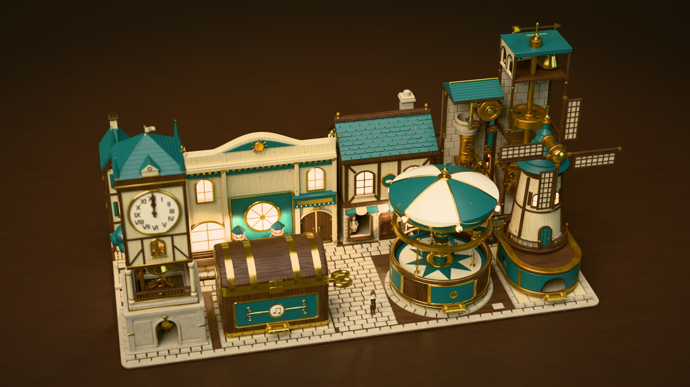
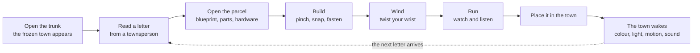
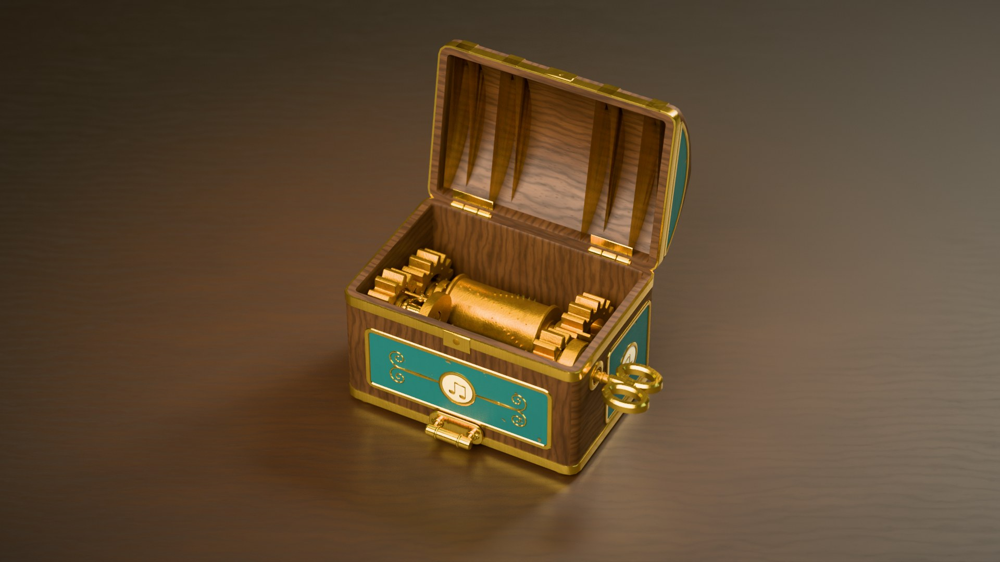
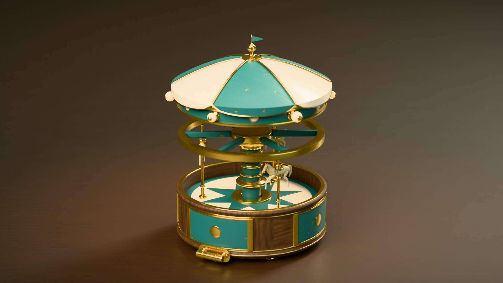
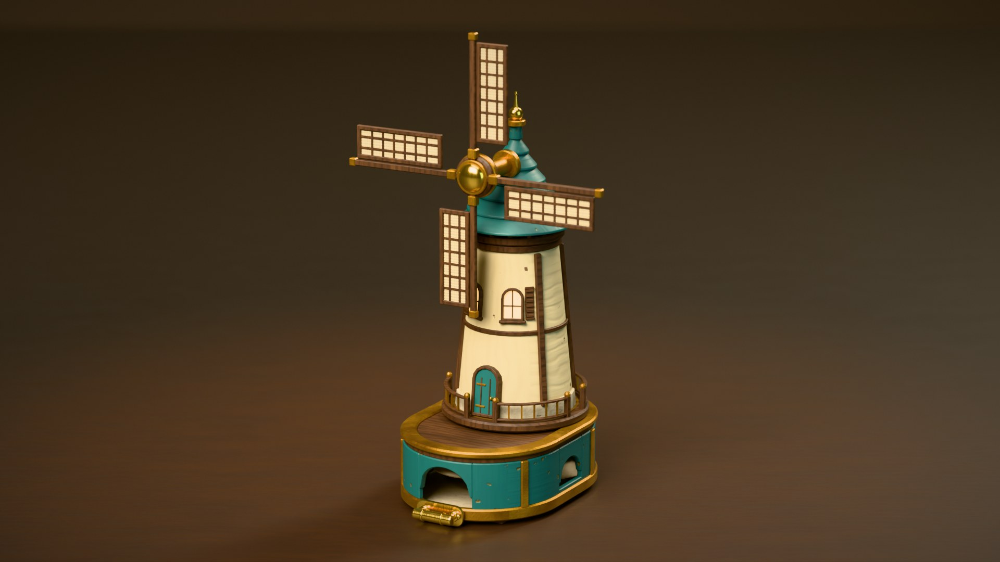
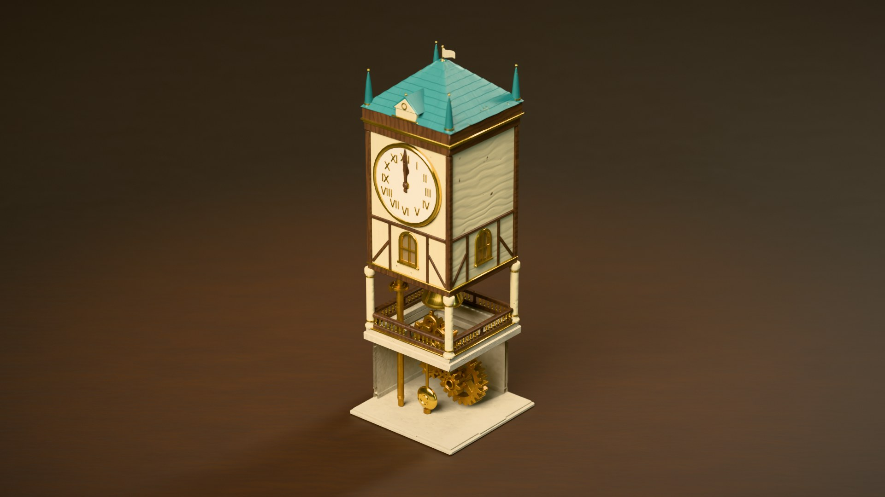
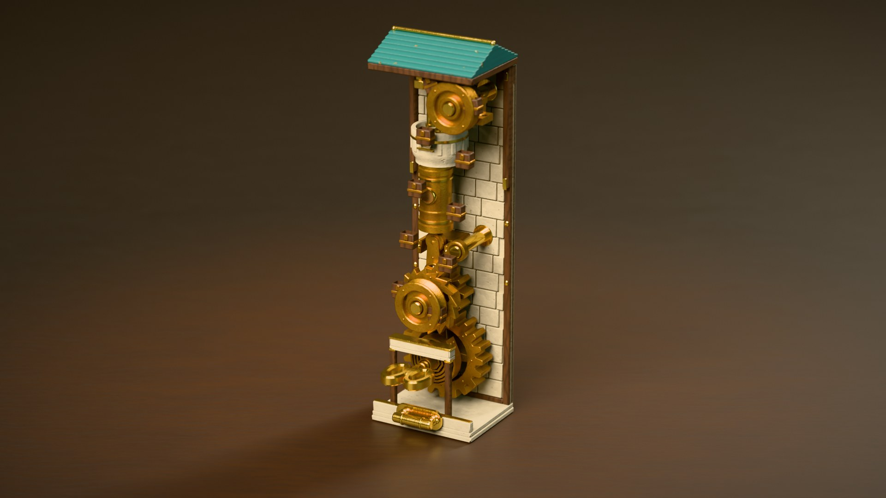
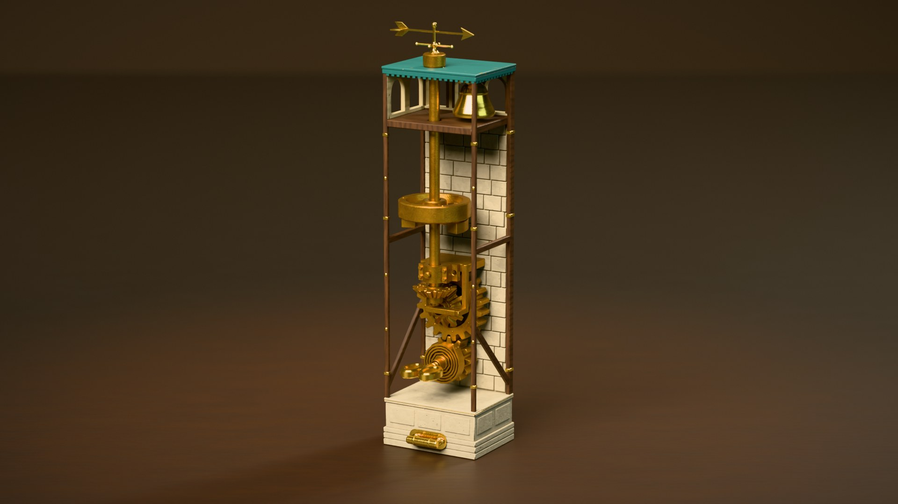
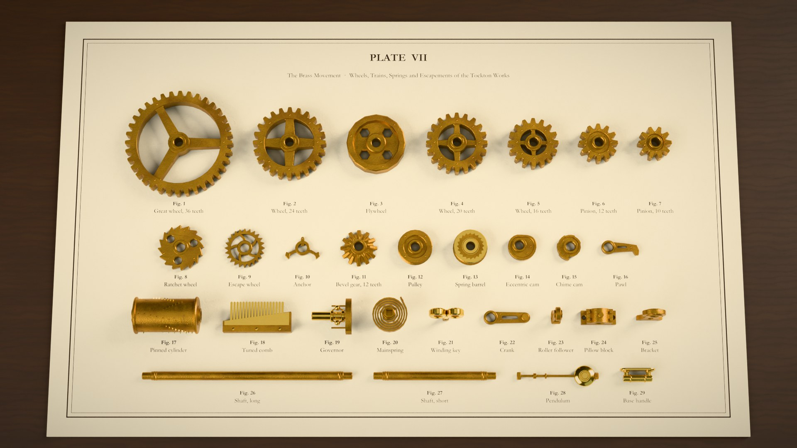
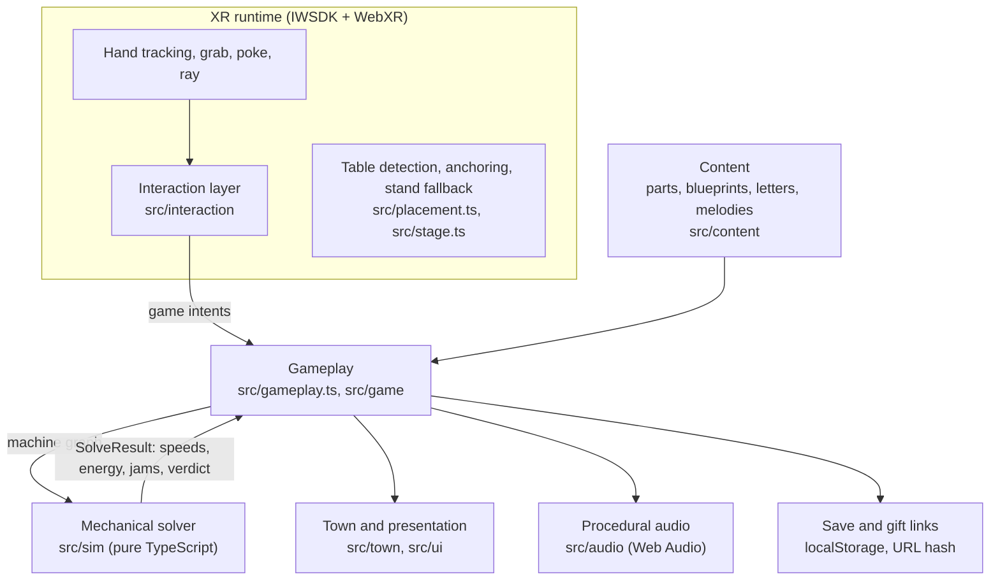

<div align="center">

# Wound Up

### Build the machines. Wake the town. Raise the curtain.

A seated, hands-only mixed-reality clockwork game for Meta Quest 3 and 3S. A miniature town sits frozen on your real table. You build its clockwork machines part by part with your bare hands, wind them up, and watch the town wake.

[](LICENSE)
[](#try-it-live)
[](https://immersiveweb.dev/)
[](https://iwsdk.dev)
[](https://threejs.org)
[](tsconfig.json)
[](blender/scripts)
[](#privacy-and-security)

**[Play it live](https://wound-up-nu.vercel.app)** · [How it plays](#how-it-plays) · [The machines](#the-six-machines) · [How it works](#how-it-works) · [Run it locally](#run-it-locally)

Built for the **Meta VR Start Developer Competition**: Gaming track, New Experience.

</div>

<p align="center">
  
</p>

> **LEGO where every piece is a real, working mechanical part.** Gears mesh at their true ratios, shafts carry the drive, a spring stores the energy your wrist winds into it, and a wrong gear makes a machine run wrong. You learn how clockwork works by building it, not by reading about it.

---

## Try it live

| | |
|---|---|
| **Website** | https://wound-up-nu.vercel.app |
| **In a headset** | Open the link in **Meta Quest Browser** on a Quest 3 or 3S and choose **Enter mixed reality**. Sit at a table and keep hand tracking on; no controllers are needed. |
| **Without a headset** | Choose **Play in your browser** on the landing page. An emulated Quest 3 (Meta's IWER emulator) runs the whole game in a desktop browser, with the mouse standing in for your hands. |
| **Cost** | Free. No install, no account, no sign-in. |

**A five-minute path.**

1. Open the trunk on the table. The frozen town of Tockton unfolds.
2. Read Mira's letter: her grandmother's music box went quiet the night the clock stopped.
3. Open the parcel. You get a blueprint, a tray of brass parts and a caddy of pins and screws.
4. Build the Music Box stage by stage. Pinch each part, bring it to its socket and feel it snap. Fasten it with its hardware.
5. Twist your wrist to wind the key, press **Run** and hear the tune.
6. Carry the Music Box to its plot. A ripple of colour, light and sound spreads through its corner of the town.

---

## Contents

- [Why we built it](#why-we-built-it)
- [How it plays](#how-it-plays)
- [The story: eight letters](#the-story-eight-letters)
- [The six machines](#the-six-machines)
- [The intricate build, difficulty and the Helper](#the-intricate-build-difficulty-and-the-helper)
- [Repairs: when a machine runs wrong](#repairs-when-a-machine-runs-wrong)
- [Hands-first interaction](#hands-first-interaction)
- [Comfort and accessibility](#comfort-and-accessibility)
- [Gifts](#gifts)
- [How it works](#how-it-works)
- [Art direction and 3D assets](#art-direction-and-3d-assets)
- [Performance](#performance)
- [Privacy and security](#privacy-and-security)
- [Testing and what has been verified](#testing-and-what-has-been-verified)
- [Tech stack](#tech-stack)
- [Run it locally](#run-it-locally)
- [Repository layout](#repository-layout)
- [Limits and honest notes](#limits-and-honest-notes)
- [License and credits](#license-and-credits)

---

## Why we built it

Mixed reality is at its best when it turns the space in front of you into something you can touch. A table is the most natural stage there is: you sit at it, you lean over it, and you work on it with your hands. We wanted a game that uses all three.

Clockwork fits that stage perfectly. It is small, tactile and honest: every part has a visible job, and when you get it right the machine moves. Most building games snap decorative pieces together. Wound Up snaps **working** parts together and simulates them, so you can see cause and effect:
- a bigger gear slows the train;
- a worn spring runs out after a moment;
- the wrong gear makes the windmill race.

We aimed for three things:
- **Satisfying in five minutes.** The first machine, the Music Box, plays its tune within the first few minutes.
- **Hands first.** Pinch, snap, twist and poke. There is no keyboard and no laser-pointer menu, and you do not need controllers.
- **Handcrafted.** A warm storybook look, inspired by antique horology catalogues, with brass, walnut and cream enamel. Every model is original.

---

## How it plays



**Frozen and awake.** Tockton starts desaturated, cool and still. Each machine you place wakes its part of the town with a 1.5-second ripple of colour: light and motion return, the Bakery's oven glows, pennants flutter, chimneys smoke and Otto the baker starts kneading.

---

## The story: eight letters

The town stopped "the night the clock stopped". Letters arrive one at a time, and each one unlocks after the one before it is done.

| # | From | What they ask | You |
|---|---|---|---|
| 1 | Mira | "My grandmother's music box went quiet the night the clock stopped. Could you make it sing again?" | Build the **Music Box** |
| 2 | Mira | "It plays! But only for a moment, then it sighs and stops. Is it tired?" | Repair it: find the worn spring |
| 3 | The schoolteacher | "The children press their noses to the carousel every morning. Could you make it turn again?" | Build the **Carousel** |
| 4 | Otto, the baker | "No wind, no windmill. No windmill, no flour. No flour, no bread. Please help." | Build the **Windmill** |
| 5 | Otto | "The windmill spins like it's late for something! Flour everywhere." | Repair it: find the wrong gear |
| 6 | The theatre keeper | "The theatre doors only open when the clock tower rings." | Build the **Clock Tower** |
| 7 | The gardener | "The old fountain has stood dry since the night the clock stopped." | Build the **Well** |
| 8 | The bell-ringer | "The belfry bell hasn't rung … and the weathervane has forgotten how to turn." | Build the **Belfry** |

After the story, optional letters bring extra repairs: a tune that drags, a mill that crawls, a tune that races. A **daily repair** gives you one small, deterministic fault to fix each day.

---

## The six machines

Every machine is a real gear train. The diagrams use `==` for parts on one shaft and `--mesh-->` for gears that turn each other.

<table>
<tr>
<td width="50%"></td>
<td width="50%"></td>
</tr>
<tr>
<td><b>Music Box.</b> A two-stage train. The mainspring drives a 10-tooth pinion into the 20-tooth cylinder wheel, and the pinned cylinder plucks a tuned comb. A 16:12 pair spins the governor that keeps the tempo steady.<br><code>spring == pinion 10T --mesh--> wheel 20T == cylinder == governor train</code></td>
<td><b>Carousel.</b> You wind it through a right-angle bevel pair. The spring drives a 10:16 reduction to the central shaft and platform. Pins under the platform lift the three horses, 120 degrees apart.<br><code>spring == pinion 10T --mesh--> gear 16T == shaft == platform</code></td>
</tr>
<tr>
<td></td>
<td></td>
</tr>
<tr>
<td><b>Windmill.</b> Driven by the wind, with no spring and no key. The sails turn a 12:12 bevel pair to a vertical shaft. A 12:24 reduction then drives the millstone, which feeds the Bakery.<br><code>sails == bevel --mesh--> bevel == shaft == pinion 12T --mesh--> gear 24T == millstone</code></td>
<td><b>Clock Tower.</b> A 17-socket movement with an escape wheel, an anchor, a pendulum and a dial. It keeps the town's time and rings the bell the theatre has been waiting for.</td>
</tr>
<tr>
<td></td>
<td></td>
</tr>
<tr>
<td><b>Well.</b> A 20:10 speed-up drives a cam and roller follower that stroke the pump. A pulley and belt run the bucket chain, and a ratchet and pawl click as it turns.<br><code>spring == gear 20T --mesh--> gear 10T == cam ..> follower</code></td>
<td><b>Belfry.</b> A 12:20 reduction and a 90-degree bevel drive feed an 18 cm vertical shaft. The shaft carries the motion up the tower to a flywheel, a weathervane and a rocking bell.<br><code>spring == pinion 12T --mesh--> gear 20T == bevel --90°--> bevel == shaft == flywheel</code></td>
</tr>
</table>

<p align="center">
  
</p>

---

## The intricate build, difficulty and the Helper

The Music Box is built like a real kit. You place 12 major parts by hand across 7 stages. Up to 22 pieces of brass hardware fix them in place: taper pins, dowel pins, set collars, washers, split bushes, slotted screws and angle clips. You take each piece from a parts caddy, and each one seats with its own sound and glint. A step list and a progress dial show where you are.

| Level | What it means |
|---|---|
| **Relaxed** | You place the big parts. The game seats the hardware for you. Sockets are forgiving. |
| **Standard** (recommended) | You fit the hardware yourself, from the caddy. |
| **Master** | The full kit with the tightest tolerances. The caddy bins sit 3.8 cm apart, so you pinch with care. |

You choose a level at your first build and can change it in the Pause menu.

**The Helper.** If you get stuck, press the Helper medallion beside Pause:
- Press once for a hint: the next socket glows.
- Press again for a ghost demonstration.
- Press a third time, or long-press, to place one part for you.

The Helper never builds a whole machine, never winds it and never runs it. It offers itself after repeated mistakes or a long pause, and it records nothing.

The other five machines use the simpler snap-together build. The staged, hardware-level build is Music Box only for now.

---

## Repairs: when a machine runs wrong

Repairs are where the simulation shows. The solver compares every machine against its target speed band, so a fault behaves the way it would in real clockwork:

| Fault | What you see | Why |
|---|---|---|
| Worn spring (Letter 2) | The Music Box plays for about 1.5 seconds, then sighs and stops | The spring cannot store enough energy |
| Wrong gear (Letter 5) | The millstone spins about twice as fast and flour flies everywhere | A 12-tooth gear sits where the 24-tooth gear belongs |
| Dragging tune (optional) | The tune hums slowly | A 24-tooth gear where the 20-tooth cylinder wheel belongs: 0.33 rad/s instead of 0.4 |
| Racing tune (optional) | The tune races | A 12-tooth gear where the 10-tooth spring pinion belongs: 0.48 rad/s instead of 0.4 |
| Crawling mill (optional) | The millstone crawls | A 10-tooth gear where the 12-tooth pinion belongs |

You find the faulty part, pull it out and fit the right one. The **X-ray lens** helps: it fades a machine's casing so you can see the mechanism inside while it runs.

---

## Hands-first interaction

| Gesture | What it does |
|---|---|
| **Pinch and carry** | Lift a part from the tray or the caddy. |
| **Snap** | Bring a part near its socket. It is drawn in and seats with a click. A part that does not belong there is refused. |
| **Wrist twist** | Wind a key. Each quarter turn adds one unit of spring energy, up to two full turns. |
| **Poke** | Press brass plaques and medallions: Run, Pause, Helper, X-ray. |
| **Carry a machine** | Lift a finished machine and set it on its plot in the town. |

---

## Comfort and accessibility

- **Seated by design.** Everything is within reach of a seated player at a table. If no table is detected, the town sits on a floating stand.
- **Ghost hands** show each new gesture the first time you need it.
- **Ray mode and gaze mode** let you point or look-and-pinch instead of reaching, for players who cannot reach comfortably.
- **Easy snap** makes sockets more forgiving.
- **Night mode** lowers the lights, and the town's windows and lamps glow.
- **Readable at arm's length.** Text sits on in-world plaques. There are no text keyboards in VR.

---

## Gifts

When a machine is finished, you can send it to a friend as a link. The machine is serialised, compressed and placed in the URL hash. Nothing passes through a server. Opening the link shows the machine in a gift viewer. The game treats gift data as untrusted input: every link is validated against the part catalogue and the blueprints before anything is built from it.

---

## How it works



- **The solver is the single source of truth.** `src/sim/` is pure TypeScript with no Three.js, IWSDK or browser imports. It builds a graph of the parts you placed: shafts, gear meshes, belts, cams and pins. From the graph it propagates speed and direction, checks gear ratios and spring energy, and detects jams and missing parts. It then returns a `SolveResult` with a verdict, such as "runs", "runs wrong" or "jammed". The renderer, the audio and the progression all read that result. No mechanical rule is duplicated anywhere else.
- **Content is data.** Parts, blueprints, letters and melodies are plain typed data, validated at load. A blueprint names its sockets, which parts each one accepts, and the speed band its output must hit.
- **Interaction turns hands into intents**, such as grab, seat, wind or press, using IWSDK's input APIs. Gameplay reacts to intents, never to raw input.
- **The town consumes solver output.** The wake effect, lighting, the X-ray fade and Otto's kneading all follow game state. None of them re-derive mechanics.
- **Audio is procedural.** Clicks, snaps, ratchets, the comb's tune and the bell are synthesised with the Web Audio API.

---

## Art direction and 3D assets

**Look.** A mature vintage storybook crossed with an antique horology catalogue: warm, restrained and tactile.

| Aged brass | Walnut | Cream | Deep teal | Lamp glow |
|---|---|---|---|---|
| `#C9A227` | `#5B3A24` | `#F2E6CF` | `#1F5C5C` | `#FFC66D` |

**Every model is original and generated in Blender by code.**
- **Generators.** Python scripts in `blender/scripts/` build every asset, from the trunk and the town to the six machines, the residents and every gear. They give each asset bevels, believable proportions and baked occlusion.
- **Parametric families.** Gears, pinions, shafts, springs, cams and fasteners are parametric families. Teeth, module and bore come from manifest entries, so every gear in the game meshes with every other gear at the right centre distance.
- **Materials.** A shared material library supplies aged brass, polished brass, walnut, painted wood, cream enamel, teal paint and stone. A finish is a runtime material, never a separate file.
- **Validation.** Every GLB passes a validator (`tools/validate-glb.mjs`) against the export rules. Each one is recorded with its hash in `assets/manifest/glb-manifest.json`.

The images in this README are Cycles renders of the shipped GLBs, assembled with the game's own layout code.

---

## Performance

The target is 72 fps on Quest 3, and never below 60.

- **Static batching.** Each placed machine is merged per material. Casing is baked separately, ready for the X-ray swap, so normal play costs no extra draw calls. In the emulated Quest 3, with three machines placed, a frame stays under 200 draw calls with both eyes rendered (192).
- **Simple lighting.** One hemisphere light and one directional light, with no real-time shadows on moving parts.
- **Shared geometry and materials**, with no per-frame allocation in the animation loops.
- **Fast first load.** The landing page and its buttons are usable after about 2 seconds on desktop. The town loads in the background afterwards. If you open the trunk early, a "Waking Tockton…" cue shows until it arrives. Shaders compile in the background before you need them.

The draw-call and load-time figures above come from desktop and emulator measurements, not from a headset.

---

## Privacy and security

- **No backend.** The game is a static site. There are no accounts, no server and no database.
- **No analytics or telemetry.** No third-party requests are made at runtime. The fonts, the hand models and the controller models are self-hosted.
- **Your progress stays on your device**, in `localStorage`.
- **Strict headers.** A Content-Security-Policy and other security headers are set in `vercel.json`. A Playwright check confirms the policy breaks nothing.
- **Gift links are untrusted input.** They are validated before anything is built from them.
- **No AI or LLM calls in the game.** Everything is deterministic.

---

## Testing and what has been verified

| Layer | How |
|---|---|
| **Unit tests (Vitest)** | Over 1,500 tests cover these areas: <ul><li>The solver: ratios, propagation, spring energy, jams, missing sockets.</li><li>Every blueprint against its real GLBs.</li><li>Parts, letters and progression.</li><li>Save and load, and gift-link encoding and validation.</li><li>UI layout rules: reach, line of sight, hot zones.</li><li>Static batching and the X-ray shell.</li></ul> |
| **Browser journeys (Playwright)** | Covered journeys: <ul><li>Landing page and browser play.</li><li>The deferred town.</li><li>The CSP check.</li><li>Inside the emulated headset: hand interaction and wrist winding, the full Music Box build at Relaxed, Standard and Master, onboarding, ray mode, X-ray, motion and the draw-call budget, and repeat play.</li></ul> |
| **Static checks** | Strict TypeScript, ESLint, and the GLB validator on every model. |

**Honest status.** All of this testing ran on desktop browsers and in IWER, the emulated Quest 3. **The game has not yet been tested on a physical Quest 3 or 3S.** Three things remain unverified until it has:
- real table detection and anchor stability;
- hand-tracking comfort;
- on-device frame rate.

---

## Tech stack

| Area | Technology |
|---|---|
| Platform | Meta Quest 3 / 3S, Meta Quest Browser |
| XR | WebXR mixed reality: hand tracking, plane detection, anchors |
| Framework | [Immersive Web SDK](https://iwsdk.dev) 1.1 |
| Rendering | Three.js r185 (through IWSDK) |
| Language | TypeScript (strict) |
| Build | Vite 7 |
| Simulation | Pure TypeScript graph solver |
| Audio | Web Audio API, procedural |
| 3D | Blender 5.2 (Python generators, Cycles), glTF / GLB |
| Testing | Vitest, Playwright, IWER (Immersive Web Emulation Runtime) |
| Hosting | Vercel, static only |

---

## Run it locally

You need **Node.js 24** (22.12 or later also works).

```bash
git clone https://github.com/vishavmehra/WoundUP.git
cd WoundUP
npm install

npm run dev          # IWSDK dev runtime with the Quest 3 emulator at https://localhost:8081
npm run build        # static production build in dist/
npm run preview      # serve the build locally
```

**Checks:**

```bash
npm run typecheck    # strict TypeScript
npm run lint         # ESLint
npm test             # Vitest unit tests
npm run test:e2e     # Playwright journeys against the production build
npm run assets:check # validate every GLB against its manifest entry
```

Driving the emulated headset from the command line:

```bash
npx @iwsdk/cli dev up --headless
npx @iwsdk/cli xr enter                                   # start an emulated mixed-reality session
npx @iwsdk/cli xr set-input-mode --input-json '{"mode":"hand"}'
npx @iwsdk/cli browser screenshot --output-file shot.png
```

---

## Repository layout

| Path | What lives there |
|---|---|
| `src/sim/` | The mechanical solver: pure TypeScript, no rendering |
| `src/content/` | Part catalogue, blueprints for the six machines, repairs |
| `src/game/` | Letters, progression, save, gift links, daily repair |
| `src/interaction/` | Pinch, snap, wrist wind, poke, ray and gaze modes, ghost hands |
| `src/assembly/` | The staged Music Box build, the hardware caddy and the Helper |
| `src/town/` | The Tockton diorama, wake effect, night, static batching, X-ray |
| `src/ui/` | In-world plaques, medallions, letters and the pause menu |
| `src/audio/` | Procedural Web Audio |
| `src/landing/` | The web landing page and browser-play entry |
| `src/index.ts`, `src/gameplay.ts` | Application entry and the game director |
| `public/assets/models/` | The shipped GLB models |
| `public/assets/materials/` | The shared material library |
| `blender/scripts/` | The Blender generators that build every model |
| `assets/manifest/` | The machine-readable asset manifest |
| `tools/` | GLB validator and asset tooling |
| `tests/` | Vitest unit tests, Playwright e2e and performance specs |
| `media/` | The renders used in this README |

---

## Limits and honest notes

- **Headset testing.** The game has not yet been tested on a physical Quest 3 or 3S; see [Testing](#testing-and-what-has-been-verified).
- **The intricate build** (stages, hardware, difficulty) covers the Music Box. The other five machines use the simpler snap-together build.
- **Repairs** seat their hardware automatically, so a repair is about finding the faulty part, not refastening every pin.
- **The browser emulator** is a way to try the game without a headset. Mouse-driven hands are not the intended experience.

---

## License and credits

Wound Up is released under the [MIT License](LICENSE).

All game code and all 3D models are original to this project. The models are produced by the Blender scripts in `blender/scripts/`. The code and the Blender generators were written with Claude (Anthropic) under the developer's direction.

| Third-party material | Licence |
|---|---|
| [Immersive Web SDK](https://iwsdk.dev) (`@iwsdk/core`), [IWER](https://github.com/meta-quest/immersive-web-emulation-runtime) and `@iwer/devui` | MIT, Meta Platforms, Inc. and affiliates |
| [Three.js](https://threejs.org) (`super-three`) | MIT |
| [`@pmndrs/uikit`](https://github.com/pmndrs/uikit) | MIT |
| Hand and controller models from [`@webxr-input-profiles/assets`](https://github.com/immersive-web/webxr-input-profiles) 1.0.20, unmodified | MIT, Amazon (licence files kept beside the models in `public/assets/xr/`) |
| Fonts: Elsie and Elsie Swash Caps (Alejandro Inler), Cabin (The Cabin Project Authors) | SIL Open Font License 1.1 (`public/fonts/OFL-*.txt`) |

<div align="center">

**Build the machines. Wake the town. Raise the curtain.**

</div>
