# Wound Up — Integration and Release Gates

**Project:** Wound Up
**Label:** G0 for sections 1 to 11 (the competition build). Section 12 is the entry gate for G1 to G5 and Research, which stay unbuilt until delivery ([ADR-028](DECISIONS.md)).
**Status:** Active. Extends `TESTING_QA_PLAN.md` §13 and `ACCEPTANCE_TESTS.md` §16 to §18; it removes nothing from them. Where this document adds a check (lint, asset checks, daily repair), the addition stands until those documents are updated.
**Date:** 2026-11-06
**Authority:** [production directive](directives/2026-11-05_PRODUCTION_DIRECTIVE.md) Parts 9 and 12; CLAUDE.md §2 and §18; ADR-022, ADR-025, ADR-033, ADR-034, ADR-037 in [DECISIONS.md](DECISIONS.md); [audit F](audits/F_QA_PERFORMANCE.md) §2 to §6
**Related:** [MASTER_PRODUCTION_ROADMAP.md](MASTER_PRODUCTION_ROADMAP.md), [ASSET_PRODUCTION_ROADMAP.md](ASSET_PRODUCTION_ROADMAP.md), [ASSET_QA_CHECKLIST.md](ASSET_QA_CHECKLIST.md), [AGENT_OWNERSHIP_MATRIX.md](AGENT_OWNERSHIP_MATRIX.md), [GLB_ASSET_MANIFEST.md](GLB_ASSET_MANIFEST.md), [ACCEPTANCE_TESTS.md](ACCEPTANCE_TESTS.md), [TESTING_QA_PLAN.md](TESTING_QA_PLAN.md), [COMPETITION_REQUIREMENTS.md](COMPETITION_REQUIREMENTS.md)

## Dependencies

- Extends [TESTING_QA_PLAN.md](TESTING_QA_PLAN.md) §13 and [ACCEPTANCE_TESTS.md](ACCEPTANCE_TESTS.md) §16 to §18; it removes nothing from them.
- Decisions: ADR-022 (Vercel static deployment), ADR-025, ADR-033 (folders and the `dist/` check), ADR-034 (budgets) and ADR-037 (GLB validation gate).
- Tooling the gates name: the GLB validator of ADR-037 (task AF-2), `tools/asset-status.mjs`, and the CI and build checks of task AF-5 ([MASTER_PRODUCTION_ROADMAP.md](MASTER_PRODUCTION_ROADMAP.md)). A gate whose tool is not built stays Specified, never Pass.
- Owner decisions that change a gate: [decision 2](PRODUCTION_AUDIT.md#decisions-needed-from-the-owner) (Quest tester; BUILD_ROADMAP TP-7), and decision 5 (gear module and tooth set). The defaults apply until they are answered. Decision 4 (shared material library) was answered on 2026-11-06: accepted, ADR-032.
- Inputs: `assets/manifest/glb-manifest.json` for the asset gates and [AGENT_OWNERSHIP_MATRIX.md](AGENT_OWNERSHIP_MATRIX.md) for who signs.

## 1. Purpose and rules

This document says what must be true for an asset to count as exported, validated and integrated, for a build to count as working, and for the game to be released. It lists the checks at each gate, what each kind of evidence can and cannot prove, and which release blockers only a headset can clear.

1. A gate passes only on recorded evidence. A build that compiles, or an export file that exists, proves nothing about the game (ACCEPTANCE_TESTS §19; directive Part 9).
2. Every record names its verification level. No level implies another. An IWER (IWSDK emulator) result is never promoted to a Quest result.
3. Nothing is hardware-verified today: there is no headset and no tester. Every Quest item is Blocked until a named tester produces evidence.
4. The test IDs AST-01 to AST-14 and PERF-01 to PERF-13 are proposed by audit F (§6.1, §4.2). They are not yet in `ACCEPTANCE_TESTS.md`. Until its owner adds them, the short definitions here are the working ones.
5. `DEPLOYMENT_RELEASE_PLAN.md` is a byte copy of `SIMULATION_SPEC.md` (audit A I-20). Until it is rewritten, this document, ADR-022 and `COMPETITION_REQUIREMENTS.md` §9 and §10 are the release procedure.
6. Counts of assets and statuses come from `node tools/asset-status.mjs`. They are not typed here.
7. Three families of gate share letters, so they are always written in full. "Build Gate A to D" and "Submission gate S" are the build and release gates (section 5). "Asset Gate F, P, M and C" are the pipeline gates of `ASSET_PRODUCTION_ROADMAP.md` (section 4.1). "AG1 to AG4" are per-asset gates (section 4.2). "AR" means `ASSET_PRODUCTION_ROADMAP.md` and "BR" means `BUILD_ROADMAP.md`. Task IDs (AF, AB, RL, CK) are in [MASTER_PRODUCTION_ROADMAP.md](MASTER_PRODUCTION_ROADMAP.md) §4.2 and §5; TP, DR and QA IDs are in `BUILD_ROADMAP.md`.

## 2. Vocabulary

**Test status** (the `ACCEPTANCE_TESTS.md` §3 set, which replaces the different set in `TESTING_QA_PLAN.md` §11; audit A I-25, audit F §1): Not Run, Pass, Fail, Blocked, Not Applicable. A Blocked record states the reason and the action that unblocks it.

**Task status** (`BUILD_ROADMAP.md` §18, used for milestones and tasks, not for test results): Not Started, In Progress, Blocked, Complete, Cut.

**Asset status** (`GLB_ASSET_MANIFEST.md` §5): NOT_STARTED, BLOCKED, IN_PROGRESS, SOURCE_READY, EXPORTED, VALIDATING, VALIDATED, INTEGRATED, REWORK_REQUIRED. Status and verification level are separate: an asset can be INTEGRATED on Desktop and IWER evidence alone.

**Verification levels** (directive Part 12; audit F §4.1):

| Level | Meaning | A record must carry |
|---|---|---|
| Desktop verified | Chrome or Edge on the dev machine, or CI; the 2D page and the `?debug` hooks | Command, commit, date |
| IWER verified | The IWSDK emulator with emulated Quest 3 headset, hands and rooms. It runs at about one frame per second in software, so frame rates mean nothing | Spec name, room, commit |
| Quest Browser verified | Meta Quest Browser on any Quest-family headset. Proves that browser version's WebXR behaviour, not Quest 3 or 3S performance | Device model, OS, browser version, recording |
| Physical Quest 3 verified | A Quest 3 and Quest Browser, per test ID | Same |
| Physical Quest 3S verified | A Quest 3S and Quest Browser, per test ID. Its optics, display and sensing may differ, so repeat the Quest 3 rows | Same |

**Evidence record** (ACCEPTANCE_TESTS §3): test ID, status, level, build or commit, environment (device for hardware), date, and a link to the evidence.

## 3. The gate chain

```mermaid
flowchart LR
  SRC[Source] --> AG1([AG1 source ready])
  AG1 --> EXP[Export]
  EXP --> AG2([AG2 exported])
  AG2 --> VAL[Validation]
  VAL --> AG3([AG3 validated])
  AG3 --> INT[Integration]
  INT --> AG4([AG4 integrated])
  AG4 --> GB([Build Gates B and C])
  GB --> GD([Build Gate D release candidate])
  GD --> FRZ[Code freeze Nov 16]
  FRZ --> GS([Submission gate S])
```

| Gate | Question | When | Signed by |
|---|---|---|---|
| Build Gate A Foundation | Does the base build still start, type-check, lint, test and build? | Every merge to `main`. Recorded Pass for M0 on 2026-11-06 ([PRODUCTION_AUDIT.md](PRODUCTION_AUDIT.md) §2) | CI and Agent 0 |
| Asset Gate F | Does the pipeline framework work? | Nov 7 evening (AR §4) | Agent 0, with an Opus review of the framework design |
| Asset Gate P | Does the pilot prove the pipeline well enough to scale? | Nov 8 evening (AR §5) | Agent 0, with an Opus review of measured cost and results |
| Asset Gate M | Is the Music Box fully proven end to end, so that the other machine families may scale? | After Gate P and before the Windmill, Carousel and Clock Tower machine files. No date is set (AR §5) | Agent 0 |
| Asset Gate C | Is every non-blocked G0-required entry VALIDATED? | Nov 11 evening, latest Nov 12 (AR §6) | Agent 0 |
| AG1 to AG4 | Per asset: source, export, validation, integration | Per asset | See section 4.2 |
| Build Gate B Core gameplay | Does the Music Box loop work, from table or stand to placement? | Nov 11, when batches 1 and 2 are INTEGRATED. The BR Phase 4 logic is due Nov 9 | QA role; Agent 0 signs |
| Build Gate C Feature integration | Are the other machines, save, X-ray, gift and progression in? | Nov 12 evening, after BR Phase 6 and asset Gate C | QA role; Agent 0 signs |
| Build Gate D Release candidate | Is this build fit to submit? | Nov 15 (BR Phase 9) | QA role; Agent 0 signs with an Opus final review |
| Submission gate S | Is the frozen build the one deployed and submitted? | Nov 17 to 18 | Agent 0; the owner submits |

Dates marked AR are proposals in `ASSET_PRODUCTION_ROADMAP.md`, which is for the lead's approval. The INTEGRATED dates behind Build Gates B and C are the proposals of [MASTER_PRODUCTION_ROADMAP.md](MASTER_PRODUCTION_ROADMAP.md) §4.1.

## 4. Asset gates

The stage definitions follow audit F §6.2 and `GLB_ASSET_MANIFEST.md` §5. Only the validator and a named reviewer set VALIDATED. Only the integration test or Agent 0 sets INTEGRATED. Asset agents report evidence; Agent 0 merges the manifest. The one-page checklist per asset is audit F §6.3, kept as [ASSET_QA_CHECKLIST.md](ASSET_QA_CHECKLIST.md).

### 4.1 Asset Gates F, P, M and C and the batch gate

The conditions are defined in `ASSET_PRODUCTION_ROADMAP.md`; this table adds the checks of this document.

| Gate | Passes when (AR) | Checks added here |
|---|---|---|
| Asset Gate F, Nov 7 (AR §4) | The runner regenerates `gear_spur_16_m1` into a scratch root with profile L and refuses a default path; the validator reports zero FAIL on that GLB and finds all six seeded defects of audit F §2.2; a three-gear contact sheet draws without overlap; every library name has a proxy | K7 prints no errors; the validator runs as `npm run assets:check` and inside `npm test` (K3, K8) |
| Asset Gate P, Nov 8 (AR §5) | Every pilot GLB (the AR §5 list) is VALIDATED with zero FAIL and load in the application at Desktop and IWER level; the M0 gear and stand are migrated or have a dated plan; the measured figures are within 2 times the estimates | AST-06 for each pilot GLB; the measured agent minutes and tokens are recorded per asset; owner decisions 4 and 5 are answered or their defaults accepted knowingly (Owner decision pending, [link](PRODUCTION_AUDIT.md#decisions-needed-from-the-owner)). If any figure is more than 2 times the estimate, scope is cut before more is spent, in the AR §9 order |
| Asset Gate M, no date yet (AR §5; owner decision of 2026-11-06, ADR-039 decision 6) | All eight criteria hold: all 12 approved component slots defined; correct dimensions, pivots and socket positions; GLB assets generated and validated; parts interactively assembled and snapped; the mechanical solver correctly evaluates the assembly; winding produces the intended motion; the completed Music Box can be placed in Tockton and triggers its awakening event; performance and memory budgets measured. Criterion 1 includes `music_box_slot_11` and `music_box_slot_12`, which are BLOCKED today | The Music Box entries are VALIDATED (K7, K8); the solver, winding and placement criteria are shown at Desktop and IWER level; the budget measurement is recorded. Quest figures stay Blocked without a physical Quest 3 or 3S test (ADR-039 decision 7). One line per criterion in the handoff |
| Asset Gate C, Nov 11 evening, latest Nov 12 (AR §6) | Every non-blocked G0-required entry is VALIDATED, or has a written reason and a new date | K8 zero FAIL across the manifest; K7 no disagreement between statuses, files and hashes |
| Batch gate, after each batch (AR §6) | The contact sheet is reviewed, the validator shows zero FAIL, WARN lines are answered, the handoff is received and the lead has merged the manifest | The Manifest checker's report is clean (naming, duplicates, missing fields, spec cross-check). INTEGRATED may lag a batch. After a batch integrates, scene counts and bytes must still sit inside the ADR-034 ceilings |

A family agent starts its next batch when its previous batch is VALIDATED. This follows the directive's "integrate and validate each batch before starting too many new ones" (Part 13, Phase 6).

### 4.2 Per-asset gates AG1 to AG4

| Gate | Manifest status | Evidence required | Who |
|---|---|---|---|
| AG1 Source ready | SOURCE_READY | The generator or `.blend` is committed and rebuilds; the entry is complete (category, size, origin, pivots, materials, class, budget allowance); reference approved; a clay shape-review render for hero assets; licence noted. Sizes marked `unspecified` are proposed at this stage and approved by Agent 0 | Asset agent proposes; Agent 0 approves the entry |
| AG2 Exported | EXPORTED | The generator command exits 0; the GLB path matches the entry; SHA-256 and byte size recorded; no hand edits; `node tools/asset-status.mjs` shows no disagreement | Asset agent |
| AG3 Validated | VALIDATING, then VALIDATED | `npm run assets:check` prints zero FAIL and every WARN is read and answered in the evidence; AST-01 to AST-05; previews rendered from the re-imported GLB; AST-07 for moving parts; AST-08 visual review at gameplay distance, fixed camera, game lighting, against the approved reference. VALIDATING is time-boxed to 48 hours; with no result the asset returns to EXPORTED. VALIDATED is bound to the GLB hash: any change resets it to EXPORTED | The validator, plus a named reviewer (section 10) |
| AG4 Integrated | INTEGRATED | The asset loads in the real runtime from `src/assets.ts` or content data with no console warnings (AST-06); frozen and awakened looks are right (AST-09); a grabbable part grabs, snaps and releases with emulated hands and its collider radius is at least 1.2 cm (AST-10); scene counts and bytes are still inside the ADR-034 ceilings with it present (AST-11); the production build serves it under a sub-path with the right content type and bytes matching the entry (AST-12); the asset id is referenced by a blueprint or scene. An asset whose integration takes a scene over a ceiling is not INTEGRATED (ADR-034) | Integration test, or Agent 0 |

Proposed asset test IDs, from audit F §6.1: AST-01 manifest complete; AST-02 validator zero FAIL; AST-03 WARN lines reviewed; AST-04 no duplicate geometry, near duplicates justified; AST-05 category budgets met; AST-06 loads with no warnings and the bounding box matches; AST-07 pivot test, no drift; AST-08 visual review; AST-09 frozen and awakened states; AST-10 grab, snap and release; AST-11 scene budgets after integration; AST-12 production build serves it under a sub-path; AST-13 licence row in `CREDITS.md`; AST-14 eyes-on at gameplay distance on a Quest 3 and separately on a Quest 3S, which is Blocked until a tester exists.

The M0 gear and stand GLBs are REWORK_REQUIRED with validation FAIL and are integrated at their old paths. They stay there until their replacements pass AG3, then AF-4 moves them in one change. They are the first AG4 test.

## 5. Build and submission gates

Check IDs K1 to K20 are defined in section 6.

### Build Gate A: Foundation

Runs on every merge. Checks: K1 typecheck, K2 lint, K3 unit tests, K4 build, K5 landing browser tests (desktop fallback), K6 IWER tests (basic interaction), K7 asset status with no errors, and the landing request watcher of K11. `TESTING_QA_PLAN.md` §13 Gate A lists the app starting, type checking, the production build, the desktop fallback and a basic interaction; lint is added because CLAUDE.md §18 and ADR-018 require it (audit A I-26).

### Build Gate B: Core gameplay

Target Nov 11, when batches 1 and 2 are INTEGRATED. The BR Phase 4 logic is due Nov 9. Build Gate A, and:

- The `TESTING_QA_PLAN.md` §13 items: the town stands on an emulated table and falls back to the stand; the town opens; letters progress; the Music Box assembles; the solver evaluates correctly; winding and running work; a machine can be placed. In `ACCEPTANCE_TESTS.md` these are §4.1 and §4.2 (TBL-01 to TBL-12, STAND-01 to STAND-04), §5, §6, §7, §8 (Music Box), §9 and §10.
- One full Music Box loop in IWER (K6).
- K8 asset validator: zero FAIL for every VALIDATED entry; K7 shows no disagreement.
- K9 and K10 budgets for the scenes in play, with batches 1 and 2 present.
- Hardware rows (TBL-13 to TBL-18, STAND-05) recorded Blocked with reason and action.

### Build Gate C: Feature integration

Target Nov 12 evening, after BR Phase 6. Build Gate B, asset Gate C, and:

- Carousel, Windmill and Bakery (`ACCEPTANCE_TESTS.md` §8), save and load (§12), X-ray and accessibility (§11), gift link (§13), progression (§5).
- K9 for the awakened town with every machine present. This is the heaviest scene, estimated at 150 to 190 draw calls against a 200 ceiling (audit F §3.3).
- K12 dist content and K16 leak loop.
- Batches 3 to 5 INTEGRATED.
- Optional systems may be cut if they threaten stability (`TESTING_QA_PLAN.md` §13). The scope checkpoint CK-3 decides on the Clock Tower and day/night here.

The daily repair is not in `TESTING_QA_PLAN.md` §13 Gate C because that list predates ADR-027. It is built on Nov 13 (DR-1) and is a Build Gate D item.

### Build Gate D: Release candidate

Target Nov 15 (BR Phase 9). Build Gate C, and:

- The full acceptance suite: every ID in `ACCEPTANCE_TESTS.md` has a status, and none is Not Run unless it is Not Applicable. This includes the daily repair (DAILY-01 to DAILY-05).
- The regression suite: K1 to K6.
- K8 zero FAIL across every shipped GLB; K7 no errors and no disagreements; every G0-required entry INTEGRATED, or its absence is a release blocker.
- K9, K10, K11 on XR flows, K12 and K13 pass.
- K14 deployed HTTPS smoke test on a Vercel preview with protection off.
- No P0 or P1 bugs; no critical console errors.
- Performance review: counts and bytes inside the ceilings; frame time from K15 if a tester has produced it, otherwise recorded Blocked.
- K19 the hardware checklist run, or the hardware limitation written down (section 9). `TESTING_QA_PLAN.md` §13 Gate D allows "manual headset test or clearly documented hardware-testing limitation".
- QA-1 (BR Phase 9): JUD-01 to JUD-21 each Pass, or Blocked with reason.
- The final demo flow runs.
- An Opus review of the whole (directive Part 7: critical final reviews).

### Submission gate S

Nov 17 to 18, after the code freeze of Nov 16 (BR Phase 10: no new features; only critical bug fixes; release-blocking corrections; final regression testing).

- The commit shown on the deployed page is the commit that passed Build Gate D, or a critical fix after it with the affected checks re-run.
- K1 to K6 are green on that commit; K8 zero FAIL; K11; K12.
- K14 and K20: the public Vercel URL opens in a private window with no login, deployment protection off; all assets load from the deployed path (ACCEPTANCE_TESTS §16).
- The `ACCEPTANCE_TESTS.md` §16 list: README complete; repository presentable if the owner shares it (ADR-022); demo video under three minutes, public, honest about emulator footage; submission information complete; known limitations documented.
- `COMPETITION_REQUIREMENTS.md` §10 submission checklist, including that the owner has joined the contest and is a Meta VR Start Program member.
- A final known-good build is preserved (BR Phase 12).
- Submitted before midnight IST on Nov 18. The official deadline is Nov 19, 1:30 AM IST; do not plan to use it.

After Nov 16 a change needs all of: it fixes a release blocker or a P0 or P1 bug; Agent 0 approves it; the checks for the area it touches are re-run. No new GLB is added unless it fixes a critical defect.

## 6. Check catalogue

"Exists" means it can be run today. "Specified" means a document defines it and nothing implements it yet. Task IDs (AF-n) are in [MASTER_PRODUCTION_ROADMAP.md](MASTER_PRODUCTION_ROADMAP.md) §5.

| ID | Check | Command or test | Lowest level that can pass it | State today |
|---|---|---|---|---|
| K1 | Typecheck | `npm run typecheck` (`tsc --noEmit`, strict) | Desktop | Exists; in CI |
| K2 | Lint | `npm run lint` | Desktop | Exists; in CI |
| K3 | Unit tests | `npm test` (Vitest in node): placement, stage framing, XR entry; later the solver and the asset validator wrapper | Desktop | Exists; in CI |
| K4 | Production build | `npm run build` | Desktop | Exists; in CI |
| K5 | Landing browser tests | `npm run test:e2e`, `tests/e2e/landing.spec.ts`: APP-01, APP-03, the preview flow, INT-11 preview, and a watcher that fails on any request off the origin | Desktop | Exists; not in CI |
| K6 | IWER tests | `tests/e2e/xr-emulator.spec.ts` against the IWSDK dev runtime at `https://localhost:8081`: stand placement, self-hosted hand models (ADR-025). The spec skips itself when the runtime is down, so a gate record must show that it ran and how many tests passed | IWER | Exists; local only |
| K7 | Asset status | `node tools/asset-status.mjs`: manifest checks, status against files on disk, hash agreement | Desktop | Exists |
| K8 | Asset validator | `npm run assets:check` (ADR-037): container and JSON, manifest rules V01 to V70, loader round trip with the shipped three.js, cross-manifest checks X01 to X06; zero FAIL | Desktop | Specified; AF-2 builds it. Until then no asset can pass AG3 |
| K9 | Budgets: counts | `renderer.info` per scene state through the `?debug` `__world` hook, against the ADR-034 scene table (PERF-01) | Desktop and IWER for counts | Specified; AF-7 |
| K10 | Budgets: bytes | Same-origin response sizes per scene against `budgets.json` (PERF-03; audit F §7.3) | Desktop | Specified; AF-7 |
| K11 | No third-party requests | Any request off the page's origin fails the run (ADR-025; PERF-12). One known exception: Touch controller models fetched from jsDelivr if a player uses controllers | Desktop, IWER | Landing only; XR flows specified in AF-7 |
| K12 | Dist content | `dist/` holds no GLB that is not a G0 manifest entry and no world id other than `tockton` or `shared` (ADR-033) | Desktop | Specified; AF-5 |
| K13 | Sub-path serve | The production build served under a sub-path: every asset returns 200 with the right content type and bytes matching the manifest (APP-08, AST-12) | Desktop | APP-08 is listed; the asset part is specified |
| K14 | Deployed smoke | The public Vercel URL in a private window with protection off: APP-07, APP-08, and no off-origin request | Desktop; Quest Browser for the headset view | Not started (RL-2); needs an owner action |
| K15 | Frame instrumentation | The `?perf` probe report (PERF-13): frame-time percentiles, `renderer.info` snapshots | A Quest level | Specified; AF-6 |
| K16 | Leak and soak | PERF-06: 50 assemble and tear-down cycles and 10 IWER enter and exit cycles, `renderer.info.memory` back to baseline, heap within 10%; PERF-11: a five-minute IWER soak | Desktop, IWER | Specified (audit F §4.2) |
| K17 | Acceptance IDs | Every ID in `ACCEPTANCE_TESTS.md` has a status | By the ID's type | Exists as a document |
| K18 | Judging checklist | JUD-01 to JUD-21 (QA-1) | By item | Exists as a document |
| K19 | Hardware checklist | H01 to H14 (audit F §5), once on a Quest 3 and once on a Quest 3S | Quest 3, Quest 3S | Specified (RL-1). Blocked |
| K20 | Deployment protection | Vercel protection is off and the URL opens with no login in a private window | Desktop | Owner action (ADR-022) |

A timing from a loaded laptop is recorded, not asserted. Bytes and counts are deterministic and are asserted (audit F §7.3). The e2e web server step must rebuild; `reuseExistingServer` is true today, so a stale `dist/` can pass (audit F §1), and CI must turn it off (AF-5).

## 7. What each verification level can and cannot prove

Yes means the level can produce the evidence; the record still needs a name, a build and a date. Part means a proxy only. No means it cannot. This is audit F §4.3.

| Claim | Desktop | IWER | Quest Browser | Quest 3 | Quest 3S |
|---|---|---|---|---|---|
| GLB valid; sizes; triangle, primitive and material counts | Yes | Yes | Yes | Yes | Yes |
| Draw calls and triangles per frame | Part | Part | Yes | Yes | Yes |
| GPU texture memory | Part (estimate) | Part | Part | Part | Part |
| 72 fps and the 60 fps floor | No | No | Part (a different headset, not Quest 3 or 3S performance) | Yes | Yes |
| Garbage-collection and shader hitches | No | No | Part | Yes | Yes |
| Thermal and long-session stability | No | No | No | Yes | Yes |
| Session entry and exit, feature negotiation | No | Part | Yes | Yes | Yes |
| Hand-tracking pinch accuracy and comfort | No | Part (ideal hands) | Yes | Yes | Yes |
| Plane detection and anchor on a real table | No | No (emulated planes) | Yes (API behaviour) | Yes | Yes |
| Look under real passthrough; audio levels | Part | Part | Yes | Yes | Yes |
| No third-party requests | Yes | Yes | Yes | Yes | Yes |

What the project may say, given the evidence it has:

| Claim in the README, video or Devpost | Allowed when |
|---|---|
| "Runs on Quest 3" or "runs on Quest 3S" | A Physical Quest 3 or Quest 3S record exists for that model |
| "72 fps" or "at least 60 fps" | A frame-time record on that headset (JUD-11; TBL-18) |
| "Finds your real table" | TBL-13 passed on hardware. Otherwise say the game uses plane detection and anchors when the headset provides them, tested in the emulator |
| "Tracked hands work" | A hardware record of pinch accuracy (WIND-02, WIND-03). Emulated hands prove the flow only |
| Footage in the video | Emulator footage is allowed and is labelled as emulator footage (COMPETITION_REQUIREMENTS §8; JUD-20) |

## 8. Release blockers

RB-1 to RB-10 are `ACCEPTANCE_TESTS.md` §17. RB-11 to RB-18 are added here from the ADRs named. Optional features such as the Clock Tower and day/night are not blockers if they were cut according to the roadmap.

| ID | Blocker | Source | Checked by | Level that can clear it |
|---|---|---|---|---|
| RB-1 | The Music Box loop cannot be completed | ACCEPTANCE §17 | Build Gate B full loop | IWER; Quest for the headset |
| RB-2 | Hands-first core interaction is unusable | ACCEPTANCE §17 | INT and WIND tests | IWER for the flow; Hardware for real tracking |
| RB-3 | A session fails, or play is blocked, because plane detection or anchoring is unavailable | ACCEPTANCE §17 | TBL-06, TBL-07 | IWER for the fallback; Hardware (TBL-15) for real rooms |
| RB-4 | The town jumps or drifts during a session in a way that interrupts play | ACCEPTANCE §17 | TBL-08 | IWER for logic; Hardware (TBL-14) for real drift |
| RB-5 | Machine placement or town restoration is broken | ACCEPTANCE §17 | §10 tests | IWER |
| RB-6 | The gift viewer crashes on malformed data | ACCEPTANCE §17 | §13 tests | Desktop |
| RB-7 | Production deployment cannot load | ACCEPTANCE §17 | K13, K14 | Desktop |
| RB-8 | Critical assets are missing | ACCEPTANCE §17 | K7, K8, K13 | Desktop |
| RB-9 | Critical runtime errors prevent gameplay | ACCEPTANCE §17 | K5, K6, console | IWER; Quest for the headset |
| RB-10 | Save corruption causes unrecoverable failure | ACCEPTANCE §17 | §12 tests | Desktop |
| RB-11 | A shipped GLB has a validator FAIL, or the manifest disagrees with the files, or a hash does not match | ADR-037; GLB_ASSET_MANIFEST §5 | K7, K8 | Desktop |
| RB-12 | A scene is over an ADR-034 ceiling (200 draw calls, 750k visible triangles, 128 MiB unique GPU texture memory) with no written exception from the lead in the manifest entry | ADR-034 | K9 | Desktop and IWER for counts; Quest for frame time |
| RB-13 | A download is over an ADR-034 ceiling: 4 MB before Enter, 12 MB for a scene after Enter, 60 MB for the build | ADR-034 | K10 | Desktop |
| RB-14 | A request to another origin during play, apart from the known controller-model fetch | ADR-025; CLAUDE.md §16 | K11 | Desktop, IWER |
| RB-15 | `dist/` holds a GLB that is not a G0 manifest entry, or a world id other than `tockton` or `shared` | ADR-033 | K12 | Desktop |
| RB-16 | A non-original asset has no row in `CREDITS.md` | CLAUDE.md §16; AST-13 | Manual review | n/a |
| RB-17 | Deployment protection is on, or the URL needs a login | ADR-022; COMPETITION_REQUIREMENTS §10 | K14, K20 | Desktop |
| RB-18 | The README, video or Devpost claims something no evidence backs, such as Quest verification or a frame rate | JUD-21; ACCEPTANCE §16 | RL-4 review | n/a |

RB-13 applies today. The page is about 4.9 MB compressed before Enter (audit F §7.1), against the 4 MB ceiling, because the M0 gear and stand GLBs total 4.5 MB. AF-4 and AF-8 clear it.

## 9. Hardware-only items and the no-tester rule

These cannot pass below the level shown. All are Blocked today. Reason: no headset and no named tester. Action: name a Quest 3 or Quest 3S tester ([BUILD_ROADMAP.md](BUILD_ROADMAP.md) TP-7; Owner decision 2 pending, [link](PRODUCTION_AUDIT.md#decisions-needed-from-the-owner)).

| Items | What only a headset can show | Level |
|---|---|---|
| TBL-13 to TBL-18 | Real table detection, anchor stability through the system menu, a recentre and a brief tracking loss, rooms and tables not tried, seated reach and comfort, frame rate with planes and anchors on | Quest 3 and Quest 3S |
| STAND-05 | Seated comfort on the stand | Quest 3 and Quest 3S |
| APP-04, APP-05, APP-06 | AR entry, VR fallback and clean exit on a headset. The emulator spec exercises the logic and does not promote them | Quest |
| WIND-02, WIND-03; JUD-12 | Real tracked-hand pinch accuracy and wrist rotation | Quest |
| JUD-13 | Gaze-and-pinch on a Quest. The head-directed pointer of ADR-036 is unverified on a device | Quest |
| JUD-11 | At least 60 fps (target 72) through the main loop with planes and anchors on. Hardware only | Quest 3 and Quest 3S |
| JUD-14, JUD-15 | Real detection and drift; holding up in rooms never tested | Quest |
| JUD-17 to JUD-19 | Headset audio, the look in passthrough, text readable in the headset | Quest |
| AST-14 | Each hero asset eyes-on at gameplay distance: silhouette, material, shimmer on thin edges, pivots, frozen against awakened colour | Quest 3, separately Quest 3S |
| H01 to H14 | The full tester list of audit F §5 | Quest 3, separately Quest 3S |

Also unverified by design until a Quest reading exists: how multiview counts draw calls (audit D §6.2), the Quest Browser tab memory limit, and the ADR-034 budgets themselves, which are provisional.

The rule when no tester exists at Build Gate D:

1. Each item above stays Blocked with its reason and unblock action. It is listed under known limitations (ACCEPTANCE_TESTS §16).
2. Build Gate D accepts a documented limitation in place of a headset test (`TESTING_QA_PLAN.md` §13 Gate D).
3. RB-3 and RB-4 are cleared only as far as the emulator can clear them, and the text says so.
4. RB-18 holds: no document claims Quest verification, a frame rate or real-table behaviour.
5. Whether to submit in that state is the owner's decision. The documents allow it. Owner decision pending (decision 2).
6. If a tester appears after the freeze, findings are bugs, handled under the post-freeze rule in section 5.

## 10. Who runs and signs

| Gate | Runs | Reviews or signs |
|---|---|---|
| AG1 | Asset agent | Agent 0 approves the entry |
| AG2 | Asset agent | None |
| AG3 | The validator; the Manifest checker runs the batch cross-check | The named reviewer signs AST-08. The reviewer did not build the asset: Agent 0, or a different asset agent ([ASSET_AGENT_ASSIGNMENTS.md](ASSET_AGENT_ASSIGNMENTS.md) §6). The builder never signs its own review and the Manifest checker never signs a visual review |
| AG4 | Integration test | Agent 0 |
| Asset Gates F, P, M, C and the batch gate | The Asset framework and the family agents report | Agent 0; Opus reviews the design at Gate F and the measured cost at Gate P |
| Build Gates A to D | CI for K1 to K4; the QA role (Agent 0 until a QA agent exists) for the rest | Agent 0 signs; Build Gate D adds an Opus review |
| Submission gate S | Agent 0 | Agent 0; the owner changes the Vercel setting, holds the Devpost account and submits |

## 11. Failure handling and waivers

- A failed check sets the item to Fail or Blocked in the evidence record and, for an asset, to REWORK_REQUIRED with one reason code: VAL_FAIL, REVIEW_FAIL, BUDGET_BREACH, INT_FAIL, REGRESSION or SPEC_CHANGE (audit F §6.2). It returns to SOURCE_READY if the source changes and to EXPORTED if only the export changes.
- A regression found later sets an INTEGRATED asset back to REWORK_REQUIRED with REGRESSION.
- A failed gate stops the phase after it, except where `BUILD_ROADMAP.md` §16 lets an optional feature be cut. A cut feature is marked Cut, with its assets, not deleted.
- A budget exception is a written line from the lead in the manifest entry giving the reason (ADR-034). It is not a waiver of a release blocker.
- A release blocker is cleared only by evidence at the level in section 8, or by the written limitation in section 9 where the table allows it. A G0-required feature is not cut to clear a gate; the cut order in `BUILD_ROADMAP.md` §16 applies.

## 12. Gate for the generations after the competition

G1 or any later generation, and any future world, starts only when all of these hold. Nothing in G1 to G5 is built before then (ADR-028).

1. The competition entry is submitted and the build is live and free until the winner announcement, about Dec 11 (ADR-022).
2. Hardware results are recorded, or the limitation is carried forward in writing.
3. The ADR-034 budgets are revised from the first Quest reading, or recorded as still provisional.
4. An owner decision recorded in `DECISIONS.md` moves the generation's scope into planned work.
5. For a new world: the world completion gates of the directive hold (design bible; environment and layout specification; machine and building inventory; resident and character inventory; story and quest specification; unique mechanical features; asset manifest; Blender sources and GLBs; performance budgets; gameplay acceptance tests; integration and release checklist). Generated assets alone do not complete a world. The shared asset rule applies: no duplicate shared parts without a written reason.
6. The asset gates AG1 to AG4 and the checks K7, K8, K10 and K12 apply to the new world's assets unchanged, with the GLBs kept in `assets/future/<world_id>/<family>/` (ADR-033) until a build that ships that world exists.

## 13. Acceptance criteria for this document

1. Every gate lists the checks that decide it, and every check names the level that can pass it.
2. Every hardware-only item appears in section 9, and none is described as verified.
3. Every release blocker has a source and a check.
4. No test result is quoted that was not run, and no hardware result is implied.
5. Build Gate A to D, Submission gate S, asset Gate F, P, M and C, and AG1 to AG4 are each written in full and each mean one thing.
6. Every document named in a link exists when this document is accepted.
