# Wound Up — Master Asset Inventory

**Project:** Wound Up
**Label:** G0 (competition build: Tockton and the shared mechanical library), plus 5 entries labelled G2 (post-competition)
**Status:** Inventory complete for what the documents support. No mass production has started.
**Date:** 2026-11-06
**Source of truth:** [`assets/manifest/glb-manifest.json`](../assets/manifest/glb-manifest.json). This document is a readable view of it; if the two differ, the manifest wins.
**Related:** [GLB_ASSET_MANIFEST.md](GLB_ASSET_MANIFEST.md), [WORLD_ASSET_INVENTORY.md](WORLD_ASSET_INVENTORY.md), [DECISIONS.md ADR-028 to ADR-039](DECISIONS.md), [TOCKTON_CHARACTERS.md](TOCKTON_CHARACTERS.md), [PRODUCTION_AUDIT.md](PRODUCTION_AUDIT.md), [directive Part 5 and 8](directives/2026-11-05_PRODUCTION_DIRECTIVE.md), audits [A](audits/A_DOCUMENTATION.md), [B](audits/B_REFERENCES.md), [C](audits/C_EXISTING_ASSETS.md), [E](audits/E_BLENDER_PIPELINE.md), [F](audits/F_QA_PERFORMANCE.md)

## 1. Result

The documents support exactly **68 distinct GLB deliverables** (68 entries = 43 G0-required + 20 G0-optional + 5 G2). The owner approved the inventory on 2026-11-06 as the current audited count, not as a target (ADR-039). It was 71 until the same day, when the owner removed the flower shop and the schoolteacher and theatre keeper figures (listed in `meta.removedByOwnerDecision`, not counted) and made Mira's figure G0-required. That is not the owner's 180 to 200 estimate; section 9 explains the difference in plain terms.

| Measure | Count |
|---|---:|
| Distinct GLB deliverables in the manifest | 68 |
| G0-required (the competition build cannot meet its specs without them) | 43 |
| G0-optional (competition optional: the Clock Tower set, decoy candidates, library breadth and town dressing; cut order Clock Tower, day/night toggle, decoy parts, ADR-027) | 20 |
| Future (G2 Advanced engineering; nothing for G1, G3, G4, G5 or any other world) | 5 |
| By scope class, the directive's four asset classes (`scopeClass`, [GLB_ASSET_MANIFEST.md](GLB_ASSET_MANIFEST.md) section 4): shared / world-specific / reused / future planned. Unique deliverables only; the four add up to the total | 28 / 29 / 6 / 5 |
| Blocked (an open decision decides whether the file exists or what it is) | 6 (4 G0-required, 2 G0-optional) |
| Placeholders (a spec-fixed need whose identity is undecided; counted in the total and in Blocked) | 4 |
| Identified and unblocked | 62 |
| Removed by owner decision of 2026-11-06 (ADR-039); listed in `meta.removedByOwnerDecision`, not counted | 3: `flower_shop`, `figure_schoolteacher`, `figure_theatre_keeper` |
| Entries with a GLB on disk today | 4 (the M0 gear and the M0 stand, both REWORK_REQUIRED as legacy files; `gear_spur_12_m1` and `gear_spur_24_m1`, both EXPORTED) |
| Validated | 0 (the official validator, ADR-037, does not exist yet) |
| Integrated under the new rules | 0 (the two M0 files run in the M0 scene at their old paths) |
| Third-party GLBs that ship (the two hand models, MIT), not counted | 2 |

Nothing in this inventory is verified on a Quest 3 or Quest 3S. The two existing files are Desktop and IWER verified only.

The count can rise, and section 11 lists every open decision that would raise it. The ceiling if every open question went the expensive way is about 150, still below 180.

## 2. Answers to the directive's questions (Part 8)

| Question | Answer | How to check it |
|---|---|---|
| How many GLBs are required? | 43 are G0-required and 20 are G0-optional. The total in the manifest is 68, including 5 future entries. | `node tools/asset-status.mjs`, "Competition scope" |
| How many already exist? | 4 entries have a GLB on disk: `gear_spur_16_m1` and `tockton_base_round` (as the M0 files `gear_spur_16_brass.glb` and `tockton_base_round.glb`, REWORK_REQUIRED), and the regenerated `gear_spur_12_m1` and `gear_spur_24_m1` (EXPORTED). None is validated. A regenerated `gear_spur_16_m1` file also sits at its target path; that entry stays REWORK_REQUIRED until the lead's move (ADR-033). The two hand models are third party and not counted. | tool: "entries have a GLB on disk" |
| How many are missing? | 64 of 68 have no GLB on disk. Of the 43 G0-required, 39 are missing. | tool, same line |
| Which are competition-critical? | The 43 entries labelled G0-required; the first are priority 1 to 4 (stand, trunk, workbench kit, Music Box, essential mechanical parts). | Filter `classification` in the manifest, or the tables in section 5 |
| Which are optional? | The 20 G0-optional entries: the Clock Tower set (10), library breadth (7), town content (2) and the workbench lantern (1). | Section 5 |
| Which belong to future generations? | `ratchet_wheel`, `pawl_standard`, `flywheel_standard`, `coupling_rigid`, `worm_gear`, all G2. No entry exists for G1, G3, G4, G5 or the five proposed worlds. | [WORLD_ASSET_INVENTORY.md](WORLD_ASSET_INVENTORY.md) |
| Which agent owns each asset? | Mechanical library 24, Machines 27, World 17. One owner per entry (directive Part 7.4); roles from PRODUCTION_AUDIT §12. | `owner` field; section 5 "Owner" column |
| Which references guide it? | Each entry lists its boards in `references`. 58 of 68 have at least one board; 10 have none (`music_box_slot_11`, `music_box_slot_12`, `theatre_facade`, `parcel`, `letter_envelope`, `machine_base_handle`, `run_lever`, `tockton_base_round`, `gift_box`, `gift_engraving_plate`). The Art Direction board applies to all (`meta.globalReferences`). | `references`, `boardExists` |
| Which specifications govern it? | Each entry lists sections in `specifications`. 51 of 68 are named or fixed by a written spec; 17 come from boards only (section 5, "Spec" column = no). | `specifications`, `specExists` |
| Which assets depend on other assets? | The `dependencies` field, drawn in section 7. Machine slots that use library files are in section 6. | Section 6 and 7 |
| Which have been exported? | 2 under the new pipeline: `gear_spur_12_m1` and `gear_spur_24_m1` (status EXPORTED, forge run of 2026-11-06, awaiting the reviewer). The two M0 GLBs were exported before the pipeline existed and are REWORK_REQUIRED. | tool: "Exported, awaiting validation" |
| Which have been validated? | 0. | tool: "Existing validated" |
| Which are integrated into the game? | 0 under the new rules. The M0 gear and stand are loaded by the M0 scene (`public/scenes/main.iwsdk.scene.json`, `src/assets.ts`) at their old paths. | tool: "Integrated"; section 4 |

## 3. How the list was built

**Inputs.** The ten asset families of directive Part 5.2 (A to J), the asset requirements extracted from the written specs in [audit A §2](audits/A_DOCUMENTATION.md), the 27 reference boards in [audit B](audits/B_REFERENCES.md), the existing files in [audit C](audits/C_EXISTING_ASSETS.md), and the packaging rules ADR-030, ADR-031, ADR-033 and ADR-034. Written specs win over boards for counts, sizes and mechanics (ADR-029); boards supply appearance and, where a spec fixes a slot count but names few slots, the best available list of what fills them.

**Rules applied.**

1. One entry is one distinct mesh set with its own purpose. The id has no finish. A finish is a runtime material, so the 69 gear "variants" of ART §11 are at most 23 files (ADR-030 item 2).
2. A repeated piece is one file placed several times. Six canopy lamps, four ribs, three horses and four feet are instances (ADR-030 item 3).
3. A part named by a written spec gets an entry. A part named only by a board gets an entry only where a machine's board row needs that kind of part (G0-required for a Must machine, G0-optional for the Clock Tower); it is marked `specExists: false` and provisional.
4. Decorative and structural board rows (finials, panels, feet, railings, shutters) are named nodes of one housing file per machine section (ADR-030 item 4). They become separate files only if a blueprint makes them separate player-placed slots. That would add up to 43 files (section 11).
5. Where a spec fixes a slot count and no document supports some slots, a BLOCKED placeholder holds each one. No geometry is invented for it.
6. Where the question is whether a file exists at all (Run lever model or UI, engraving plate or UI text, houses, props), the entry is BLOCKED and says what decides it.
7. No assembled-machine file is made: it would repeat part geometry (ADR-030 item 5).
8. Future entries: only shared mechanical parts with a documented basis. No entry for any world other than Tockton (directive, multiple-worlds requirement sections 8 and 9; ADR-028 rule 4).
9. Labels follow ADR-028. G0-required means a G0 requirement cannot be met without the file, or the file is a slot of a Must machine. G0-optional follows ART §11, ART §18 and PRODUCT_SPEC §19 (Clock Tower, day/night, decoys).

**Budgets** in the manifest are the ADR-034 category ceilings, not allowances. Stage 1 of each asset sets an allowance so the scene totals of ADR-034 hold (400,000 visible triangles, 150 to 200 draw calls).

**Sizes.** The `Size (basis)` column says where each number comes from: `spec` (written), `measured` (the shipped file), `derived` (computed from the gear generator's module), `board` (appearance only, ADR-029) or `unspecified` (Stage 1 proposes it and the lead approves). 52 of 68 entries have no size yet. The board sizes of the four machines (0.24 to 0.38 m wide, up to 0.72 m tall) do not fit the 0.45 x 0.25 m workbench or the 0.60 x 0.40 m town (gap G-08), so the lead needs to publish a footprint table before the Carousel, Windmill and Clock Tower start.

## 4. Existing assets: real state

| File | State | Why it does not pass the new rules |
|---|---|---|
| `public/assets/models/props/gear_spur_16_brass.glb` (entry `gear_spur_16_m1`) | Exported and integrated in M0 (scene node `gear-16`, key `gear-spur-16-brass`). Desktop and IWER verified. Status REWORK_REQUIRED, validation FAIL. | 3,872 triangles (limit 4,000, passes). 2.38 MB (2.27 MiB) against 250 KB. 3 embedded 1024 px images, 16 MiB of GPU texture against 0 (ADR-032, ADR-034). Finish baked into the id. About 94 percent of the bytes are images. |
| `public/assets/models/environment/tockton_base_round.glb` (entry `tockton_base_round`) | Exported and integrated in M0 (scene node `stand`, key `tockton-base-round`). IWER verified. Status REWORK_REQUIRED, validation FAIL. | 5,792 triangles, 3 materials. 2.12 MB (2.02 MiB), 9 embedded images, 20 MiB of GPU texture against the 16 MiB hero-pool cap. The two files together are 4.5 MB before Enter against a 3.0 MB target (GLBs 1.5 MB). |
| `public/assets/xr/generic-hand/left.glb`, `right.glb` | Third party (MIT, WebXR Input Profiles 1.0.20), 94 KB each. Listed in `thirdParty`, not counted. | Not a production deliverable. Ghost hands reuse them with recorded joint data; no new GLB. |
| `blender/exports/variants/gear_spur_12_brass.glb`, `gear_spur_24_brass.glb` | Helper renders for the composition image. In git, not shipped, their `.blend` sources deleted. Not in the manifest (ADR-033). | The library files `gear_spur_12_m1` and `gear_spur_24_m1` replace them; both are now regenerated with the new profile and recorded EXPORTED in the manifest. |
| `blender/source/gear_spur_16_brass.blend`, `tockton_base_round.blend` | Sources of the two M0 files; kept as the record of the old build. | The new source is the generator plus the manifest entry (ADR-033). |
| `blender/scripts/`: `wu_common.py`, `gen_gear_spur.py`, `gen_tockton_base.py`, `compose_m0_stage.py` | Working generators. `gen_gear_spur.py` serves the whole spur family. | They write textured GLBs; the family forge needs the ADR-032 export profile (audit E §5.2). |

`src/` contains no procedural geometry, so every visible 3D object today is one of these GLBs. The move from the old paths to `shared/spur_gear/` and `tockton/environment/` is one lead change that updates `src/assets.ts`, the scene JSON, `blender/README.md` and the manifest together (ADR-033).

## 5. Inventory by family

Columns: **Label** G0-required, G0-optional or the generation label; **Owner** the single production owner; **P** priority rank from ART §18 (1 trunk, 2 workbench, 3 Music Box, 4 essential mechanical parts, 5 town base and plots, 6 Bakery and Windmill, 7 Carousel, 8 gift box, 9 supporting props, 10 Clock Tower and optional, 11 after the competition); **Spec** whether a written spec names the item or fixes its function; **Boards** the reference boards that show it (short names in section 13).

### A. Mechanical component library (19)

Gears, shafts, springs, governor, winding key, bearing, bracket and the library breadth the specs list. Shared by every machine and every future world.

| ID | Name | Label | Owner | P | Status | Spec | Boards | Size (basis) |
|---|---|---|---|---|---|---|---|---|
| `gear_spur_16_m1` | Spur gear, 16 teeth | G0-required | Mech. library | 4 | REWORK_REQUIRED | no | Spur Gear Board, Gear Assembly Sheet, Parts Catalogue, Gear Trains Infographic | 0.064 x 0.064 x 0.0152 m (measured) |
| `gear_spur_12_m1` | Spur gear, 12 teeth | G0-required | Mech. library | 4 | NOT_STARTED | yes | Parts Catalogue, Spur Gear Board, Gear Assembly Sheet | 0.0495 x 0.0495 x 0.0152 m (derived) |
| `gear_spur_24_m1` | Spur gear, 24 teeth | G0-required | Mech. library | 4 | NOT_STARTED | yes | Parts Catalogue, Spur Gear Board, Gear Assembly Sheet | 0.0929 x 0.0929 x 0.0152 m (derived) |
| `gear_spur_10_m1` | Spur gear, 10 teeth | G0-optional | Mech. library | 10 | NOT_STARTED | yes | Parts Catalogue | 0.0423 x 0.0423 x 0.0152 m (derived) |
| `gear_spur_20_m1` | Spur gear, 20 teeth | G0-optional | Mech. library | 10 | NOT_STARTED | yes | Parts Catalogue, Gear Train Guide | 0.0785 x 0.0785 x 0.0152 m (derived) |
| `gear_spur_36_m1` | Spur gear, 36 teeth | G0-optional | Mech. library | 10 | NOT_STARTED | yes | Parts Catalogue | 0.1363 x 0.1363 x 0.0152 m (derived) |
| `gear_bevel_12` | Bevel gear, 12 teeth | G0-required | Mech. library | 4 | NOT_STARTED | yes | Carousel 20-Part, Windmill 24-Part, Parts Catalogue, Gear Train Guide | unspecified |
| `shaft_short` | Shaft, short | G0-required | Mech. library | 4 | NOT_STARTED | yes | Parts Catalogue, Gear Assembly Sheet, Music Box Assembly | unspecified |
| `shaft_long` | Shaft, long | G0-required | Mech. library | 4 | NOT_STARTED | yes | Parts Catalogue, Gear Assembly Sheet, Carousel 20-Part | unspecified |
| `spring_standard` | Mainspring, standard | G0-required | Mech. library | 4 | NOT_STARTED | yes | Springs and Winding, Music Box Mechanism, Parts Catalogue | unspecified |
| `spring_worn` | Mainspring, worn | G0-required | Mech. library | 4 | NOT_STARTED | yes | Springs and Winding, Music Box Mechanism, Parts Catalogue | unspecified |
| `governor_standard` | Governor | G0-required | Mech. library | 4 | NOT_STARTED | yes | Parts Catalogue, Gear Train Guide | unspecified |
| `winding_key` | Winding key | G0-required | Mech. library | 4 | NOT_STARTED | yes | Springs and Winding, Parts Catalogue | 0.06 x - x 0.045 m (board) |
| `bearing_pillow_block` | Pillow-block bearing | G0-required | Mech. library | 4 | NOT_STARTED | no | Gear Assembly Sheet, Carousel 20-Part, Windmill 24-Part | unspecified |
| `bracket_support` | Support bracket | G0-required | Mech. library | 4 | NOT_STARTED | no | Music Box Exploded, Music Box Assembly, Carousel 20-Part, Clock Tower 32-Part | unspecified |
| `pulley_standard` | Pulley | G0-optional | Mech. library | 10 | NOT_STARTED | yes | Parts Catalogue, Gear Train Guide | unspecified |
| `cam_eccentric` | Cam, eccentric | G0-optional | Mech. library | 10 | NOT_STARTED | yes | Mechanisms Sheet | unspecified |
| `follower_roller` | Cam follower, roller | G0-optional | Mech. library | 10 | NOT_STARTED | yes | Mechanisms Sheet | unspecified |
| `crank_standard` | Crank | G0-optional | Mech. library | 10 | NOT_STARTED | yes | Mechanisms Sheet | unspecified |

- Only the 7 gear files that the documents let us name are entered (tooth counts 10, 12, 16, 20, 24, 36 and the bevel 12). The rest of the ART §11 library is listed under "Open decisions" (section 11), not as entries.
- Governor and winding key are filed under their own folder names because `PartFamily` has no value for them (gap A-01). The lead should add them or map them to `structural`.
- `bearing_pillow_block` and `bracket_support` come from board rows only. Both are G0-required because Must machines (Carousel, Windmill, Music Box) show them, and both are provisional until the blueprints exist.
- Pulley, cam, follower and crank are G0-optional: ART §11 lists the categories, no Must machine uses them.

### B. Trunk and workshop (9)

The first physical objects the player meets and the workbench kit.

| ID | Name | Label | Owner | P | Status | Spec | Boards | Size (basis) |
|---|---|---|---|---|---|---|---|---|
| `trunk_main` | Trunk | G0-required | World | 1 | NOT_STARTED | yes | Trunk Infographic, Trunk Assembly Board | 0.35 x 0.2 x 0.25 m (spec) |
| `workbench` | Workbench | G0-required | World | 2 | NOT_STARTED | yes | Workbench Blueprint, Trunk Infographic | 0.45 x - x 0.25 m (spec) |
| `parts_tray` | Parts tray | G0-required | World | 2 | NOT_STARTED | yes | Workbench Blueprint, Trunk Infographic | unspecified |
| `parcel` | Parcel | G0-required | World | 2 | NOT_STARTED | yes | none | unspecified |
| `letter_envelope` | Letter and envelope | G0-required | World | 2 | NOT_STARTED | yes | none | unspecified |
| `blueprint_sheet` | Blueprint sheet | G0-required | World | 2 | NOT_STARTED | yes | Workbench Blueprint, Trunk Infographic | unspecified |
| `machine_base_handle` | Machine base handle | G0-required | World | 3 | NOT_STARTED | yes | none | unspecified |
| `lantern_workbench` | Workbench lantern | G0-optional | World | 9 | NOT_STARTED | no | Trunk Infographic, Trunk Assembly Board, Workbench Blueprint | unspecified |
| `run_lever` | Run lever | G0-required | World | 4 | BLOCKED | yes | none | unspecified |

- Trunk size is the spec (35 x 25 x 20 cm), not the board (60 x 34 x 32 cm) (ruling I-5).
- The tray, parcel, letter and blueprint sheet are single files reused by every machine and letter. Blueprint illustrations and letter text are not GLBs (section 8).
- `run_lever` is BLOCKED until the lead rules whether the Run control is a model or a UI control (A-11).

### C. Music Box (5)

The case, cylinder and comb. Its other parts are library files (family A).

| ID | Name | Label | Owner | P | Status | Spec | Boards | Size (basis) |
|---|---|---|---|---|---|---|---|---|
| `music_box_case` | Music Box case | G0-required | Machines | 3 | NOT_STARTED | yes | Music Box Design, Music Box Exploded, Music Box Assembly, Music Box Mechanism | 0.24 x 0.16 x 0.14 m (board) |
| `cylinder_music_box` | Music Box cylinder | G0-required | Machines | 3 | NOT_STARTED | yes | Music Box Design, Music Box Assembly, Music Box Mechanism | 0.05 x 0.05 x 0.14 m (board) |
| `comb_music_box` | Music Box comb | G0-required | Machines | 3 | NOT_STARTED | yes | Music Box Design, Music Box Assembly, Music Box Mechanism | unspecified |
| `music_box_slot_11` | Music Box slot 11 (unidentified) | G0-required | Machines | 3 | BLOCKED (placeholder) | yes | none | unspecified |
| `music_box_slot_12` | Music Box slot 12 (unidentified) | G0-required | Machines | 3 | BLOCKED (placeholder) | yes | none | unspecified |

- PRODUCT_SPEC §6.1 fixes 12 parts but names 4. The two placeholders hold slots no document supports; see the Music Box slot map in section 6.
- Cylinder and comb are filed in the shared folders (`cylinder`, `comb`) because they are library part families, but Machines owns them so the cylinder pins, comb tines and case are designed together.

### D. Carousel (6)

Six machine-specific files; its gears, shaft, bearings and brackets are library files.

| ID | Name | Label | Owner | P | Status | Spec | Boards | Size (basis) |
|---|---|---|---|---|---|---|---|---|
| `carousel_platform` | Carousel platform and poles | G0-required | Machines | 7 | NOT_STARTED | yes | Carousel 20-Part, Carousel Hero (9 rows) | 0.28 x - x 0.28 m (board) |
| `carousel_horse` | Carousel horse | G0-required | Machines | 7 | NOT_STARTED | yes | Carousel 20-Part, Carousel Hero (9 rows) | unspecified |
| `carousel_canopy` | Carousel canopy | G0-required | Machines | 7 | NOT_STARTED | yes | Carousel 20-Part, Carousel Hero (9 rows) | unspecified |
| `carousel_lamp` | Carousel canopy light | G0-required | Machines | 7 | NOT_STARTED | yes | Carousel 20-Part, Carousel Hero (9 rows) | unspecified |
| `carousel_column` | Carousel column and upper frame | G0-required | Machines | 7 | NOT_STARTED | no | Carousel 20-Part, Carousel Hero (9 rows) | unspecified |
| `carousel_base` | Carousel base | G0-required | Machines | 7 | NOT_STARTED | no | Carousel 20-Part, Carousel Hero (9 rows) | unspecified |

- The 20-row board (not the 9-row board) is used for the part list because it matches the spec count and speed (0.5 rad/s).
- Red canopy stripes on the boards are outside the palette; use cream and deep teal.

### E. Windmill and Bakery (5)

Four Windmill files and the Bakery building.

| ID | Name | Label | Owner | P | Status | Spec | Boards | Size (basis) |
|---|---|---|---|---|---|---|---|---|
| `windmill_sails` | Windmill sails | G0-required | Machines | 6 | NOT_STARTED | yes | Windmill 24-Part, Windmill Blueprint (8 rows) | 0.32 x 0.32 x - m (board) |
| `windmill_millstone` | Windmill millstone | G0-required | Machines | 6 | NOT_STARTED | yes | Bakery Awakening | unspecified |
| `windmill_tower` | Windmill tower | G0-required | Machines | 6 | NOT_STARTED | yes | Windmill 24-Part, Windmill Blueprint (8 rows) | unspecified |
| `windmill_base` | Windmill base | G0-required | Machines | 6 | NOT_STARTED | no | Windmill 24-Part, Windmill Blueprint (8 rows) | unspecified |
| `bakery_building` | Bakery | G0-required | Machines | 6 | NOT_STARTED | yes | Bakery Awakening, Town Guide-1, Town Sheet-2 | unspecified |

- Ambient wind drives the sails (ruling I-7). Whether the player also winds the Windmill is open (G-01).
- The spec requires a millstone that the 24-row board omits; `windmill_millstone` is entered from the spec and the slot arithmetic is flagged (section 6).
- The Bakery has no spec part count; the board says 16 and shows a mixer and conveyor the spec does not mention. One building file, static first (BUILD_ROADMAP §7).

### F. Clock Tower and Theatre (11)

The theatre facade is G0-required (it is part of the frozen town); everything else here belongs to the Clock Tower, which is G0-optional and cut first.

| ID | Name | Label | Owner | P | Status | Spec | Boards | Size (basis) |
|---|---|---|---|---|---|---|---|---|
| `theatre_facade` | Theatre facade | G0-required | Machines | 5 | NOT_STARTED | yes | none | unspecified |
| `clock_tower_shell` | Clock Tower shell | G0-optional | Machines | 10 | NOT_STARTED | yes | Clock Tower 32-Part, Clock Tower Guide (8 rows) | unspecified |
| `clock_tower_base` | Clock Tower base | G0-optional | Machines | 10 | NOT_STARTED | no | Clock Tower 32-Part, Clock Tower Guide (8 rows) | unspecified |
| `clock_face` | Clock face | G0-optional | Machines | 10 | NOT_STARTED | yes | Clock Tower Guide (8 rows), Clock Tower 32-Part | 0.16 x 0.16 x - m (board) |
| `clock_hands` | Clock hands | G0-optional | Machines | 10 | NOT_STARTED | yes | Clock Tower Guide (8 rows) | unspecified |
| `clock_bell` | Clock bell | G0-optional | Machines | 10 | NOT_STARTED | yes | Clock Tower 32-Part, Clock Tower Guide (8 rows) | unspecified |
| `pendulum_clock` | Pendulum | G0-optional | Machines | 10 | NOT_STARTED | yes | Clock Tower 32-Part, Clock Tower Guide (8 rows) | unspecified |
| `escapement_wheel` | Escape wheel | G0-optional | Machines | 10 | NOT_STARTED | no | Clock Tower 32-Part, Clock Tower Guide (8 rows) | unspecified |
| `escapement_anchor` | Escapement anchor | G0-optional | Machines | 10 | NOT_STARTED | no | Clock Tower 32-Part, Clock Tower Guide (8 rows) | unspecified |
| `cam_hourly_chime` | Hourly chime cam | G0-optional | Machines | 10 | NOT_STARTED | no | Clock Tower 32-Part, Clock Tower Guide (8 rows) | unspecified |
| `spring_barrel` | Spring barrel | G0-optional | Machines | 10 | NOT_STARTED | no | Clock Tower 32-Part, Springs and Winding | unspecified |

- The spec requires clock hands that the 32-row board omits; `clock_hands` is entered from the spec and the slot arithmetic is flagged.
- Escapement, pendulum, cam and barrel are generic library parts, so they sit in shared folders with world `shared`.
- No reference board shows the theatre facade. The curtain, stage and performance props from the directive list are G5 and are not entered (CLAUDE.md §14).

### G. Tockton environment (4)

The fallback stand, the town ground and two undecided town-content entries.

| ID | Name | Label | Owner | P | Status | Spec | Boards | Size (basis) |
|---|---|---|---|---|---|---|---|---|
| `tockton_base_round` | Velvet stand (Tockton base) | G0-required | World | 1 | REWORK_REQUIRED | yes | none | 0.46 x 0.045 x 0.46 m (measured) |
| `town_ground` | Town ground and plots | G0-required | World | 5 | NOT_STARTED | yes | Town Infographic, Town Guide-1, Town Sheet-2 | 0.6 x - x 0.4 m (spec) |
| `town_houses` | Town houses | G0-optional | World | 9 | BLOCKED (placeholder) | yes | Town Infographic, Town Guide-1, Town Sheet-2 | unspecified |
| `town_props_set` | Town props set | G0-optional | World | 9 | BLOCKED (placeholder) | yes | Town Guide-1, Town Sheet-2 | unspecified |

- The two M0 GLBs: only the stand is here; the gear is in family A. Both are REWORK_REQUIRED.
- The stand is 0.46 m across and cannot carry the 0.60 x 0.40 m town, so it is a separate file from the town ground. Whether they are one asset is open (G-06).
- Two entries in this family, `town_houses` and `town_props_set`, are BLOCKED because no document gives their contents (section 5). The flower shop was removed by the owner on 2026-11-06 (ADR-039).

### H. Characters and automata (2)

Two figures, both G0-required (owner decision of 2026-11-06, ADR-039; specification in [TOCKTON_CHARACTERS.md](TOCKTON_CHARACTERS.md)): Otto, the baker, whom the spec animates, and Mira.

| ID | Name | Label | Owner | P | Status | Spec | Boards | Size (basis) |
|---|---|---|---|---|---|---|---|---|
| `figure_otto` | Otto (baker) | G0-required | World | 6 | NOT_STARTED | yes | Character Board | unspecified |
| `figure_mira` | Mira | G0-required | World | 9 | NOT_STARTED | yes | Character Board | unspecified |

- Names come from the specs (PRODUCT_SPEC §7). Board names (Oswald, Elias, Luna, Pip, Clack, Tinkerer) are not used unless the owner approves (ruling I-8). The player is hands-only and has no body model.
- Otto is the baker (owner decision of 2026-11-06, ADR-039; gap G-10 is closed), so `figure_otto` is the baker and there is no separate baker figure. The schoolteacher and the theatre keeper are roles with no figure, and their entries were deleted.

### I. Gift and presentation (2)

The wrapped gift and one undecided engraving carrier.

| ID | Name | Label | Owner | P | Status | Spec | Boards | Size (basis) |
|---|---|---|---|---|---|---|---|---|
| `gift_box` | Gift box | G0-required | World | 8 | NOT_STARTED | yes | none | unspecified |
| `gift_engraving_plate` | Gift engraving plate | G0-required | World | 8 | BLOCKED | yes | none | unspecified |

- The ribbon icon on finished machines, the gift panel and the viewer interface are UI, not GLBs.
- `gift_engraving_plate` is BLOCKED until the lead rules where the engraving is shown (G-09).

### J. Future-generation assets (5)

Only shared mechanical parts with a documented basis. Outside `public/`. No world entries.

| ID | Name | Label | Owner | P | Status | Spec | Boards | Size (basis) |
|---|---|---|---|---|---|---|---|---|
| `ratchet_wheel` | Ratchet wheel | G2 | Mech. library | 11 | NOT_STARTED | no | Springs and Winding, Parts Catalogue | unspecified |
| `pawl_standard` | Pawl | G2 | Mech. library | 11 | NOT_STARTED | no | Springs and Winding, Parts Catalogue | unspecified |
| `flywheel_standard` | Flywheel | G2 | Mech. library | 11 | NOT_STARTED | no | Parts Catalogue | unspecified |
| `coupling_rigid` | Rigid shaft coupling | G2 | Mech. library | 11 | NOT_STARTED | no | Gear Assembly Sheet, Gear Train Guide | unspecified |
| `worm_gear` | Worm gear | G2 | Mech. library | 11 | NOT_STARTED | no | Parts Catalogue, Gear Train Guide | unspecified |

- Five G2 entries from the directive Part 5.2 A list and the Parts Catalogue, Gear Assembly Sheet, Springs and Winding and Gear Train Guide boards. Their solver edge types (one-way, worm, inertia) are outside the five that MECHANICAL_SOLVER_SPEC §8 allows, so they need a mechanical engine v2 decision first.
- No G1, G3, G4 or G5 entries and no world entries exist (ADR-028 rule 4). Family-level outlines are in WORLD_ASSET_INVENTORY.md.

### Blocked entries and what each waits for

| ID | Label | What it waits for | Who decides |
|---|---|---|---|
| `music_box_slot_11` | G0-required | Gap G-12 (audit A §3.2): no blueprint data exists. Only 4 of 12 Music Box parts are named in writing; 6 more rows (drive gear, pinion, shaft, bracket, winding key, case) are supported by the boards; this slot has no support in either. | Lead: authors the Music Box blueprint |
| `music_box_slot_12` | G0-required | Gap G-12 (audit A §3.2): no blueprint data exists. Only 4 of 12 Music Box parts are named in writing; 6 more rows (drive gear, pinion, shaft, bracket, winding key, case) are supported by the boards; this slot has no support in either. | Lead: authors the Music Box blueprint |
| `run_lever` | G0-required | Gap A-11 (audit A §2.2): PRODUCT_SPEC §10 says "A Run lever starts the machine", but INTERACTION §14, GAMEPLAY §10.2 and UI_UX §12 say "accessible Run control". Whether it is a physical model or a UI control is undecided. If it is UI, delete this entry. | Lead: rules model or UI control |
| `town_houses` | G0-optional | Gap G-07 (audit A §3.2): PRODUCT_SPEC §3.3 lists only four plots, a bakery and a theatre facade; PROJECT_BIBLE §2 adds "miniature buildings" with no count. ART §18 defers decorative assets until the gameplay assets are done. | Lead: footprint and town contents |
| `town_props_set` | G0-optional | Gap G-07: no spec or board gives the contents or counts. ART §18 says supporting props wait until the gameplay assets are done. | Lead: footprint and town contents |
| `gift_engraving_plate` | G0-required | Gap G-09 (audit A §3.2): PRODUCT_SPEC §13 lists 8 preset engravings and never says where they appear (on a plate, a tag, the machine base or only in the panel). | Lead: rules where the engraving shows |

A blocked entry has no geometry and no invented size. It moves to NOT_STARTED when the decision is recorded in DECISIONS.md and the manifest entry is updated.

## 6. Machine slot maps

PRODUCT_SPEC §6 fixes 12, 20, 24 and 32 parts. ADR-030 item 3 reads that as unique part slots, with repeated pieces as instances. The writing names very few of them, so each map lists the board rows that fit the count, shows which file fills each row, and records what does not fit. Slot maps are in the manifest as `machineSlotPlans`; the lead replaces them with real blueprints (DATA_AND_BLUEPRINT_SPEC §5, gap G-12).

### Music Box (12 slots, PRODUCT_SPEC §6.1)

Named in writing: 4. Rows mapped: 10 of 12. Physical pieces on the board (audit B): 18.

| Slot row | Qty | Fills | How | Basis |
|---|---|---|---|---|
| main spring | 1 | `spring_standard`, `spring_worn` | library file | spec |
| cylinder | 1 | `cylinder_music_box` | own file | spec |
| comb | 1 | `comb_music_box` | own file | spec |
| governor | 1 | `governor_standard` | library file | spec |
| drive gear (large) | 1 | - | library gear, tooth count undecided (G-11) | board |
| pinion (small) | 1 | - | library gear, tooth count undecided (G-11) | board |
| shaft | 1 | `shaft_short` | library file | board |
| support bracket | 2 | `bracket_support` | library file | board |
| winding key | 1 | `winding_key` | library file | spec and board |
| case: lid, hinge x2, box body, side panel x2, foot x4 | 1 | `music_box_case` | node of housing file | board |
| unidentified slot 11 | 1 | `music_box_slot_11` | no support | none |
| unidentified slot 12 | 1 | `music_box_slot_12` | no support | none |

- Only 4 of 12 slots are named in writing: main spring, cylinder, comb, governor (PRODUCT_SPEC §6.1).
- The 12-row Music Box boards (Exploded, Assembly) omit the governor that the spec requires; the governor is one of the 12 (ruling I-6).
- Whether the winding key and the case count inside the 12 is open (G-02). The mapping above counts both, which leaves 2 slots without any support.
- Drive gear and pinion tooth counts are undecided (G-11); they use library spur gears.

### Carousel (20 slots, PRODUCT_SPEC §6.2)

Named in writing: 4. Rows mapped: 20 of 20. Physical pieces on the board (audit B): 40.

| Slot row | Qty | Fills | How | Basis |
|---|---|---|---|---|
| finial | 1 | `carousel_canopy` | node of housing file | board |
| flag | 1 | `carousel_canopy` | node of housing file | board |
| canopy roof | 1 | `carousel_canopy` | node of housing file | board and spec (canopy) |
| canopy rib | 4 | `carousel_canopy` | node of housing file | board |
| frieze ring | 1 | `carousel_canopy` | node of housing file | board |
| lamp | 6 | `carousel_lamp` | own file | board and spec (canopy lights) |
| upper frame ring | 1 | `carousel_column` | node of housing file | board |
| central column | 1 | `carousel_column` | node of housing file | board |
| pole | 3 | `carousel_platform` | node of housing file | board |
| horse | 3 | `carousel_horse` | own file | board and spec (horses) |
| platform | 1 | `carousel_platform` | own file | spec |
| bevel gear (input) | 1 | `gear_bevel_12` | library file | board |
| spur gear (drive) | 1 | - | library gear, tooth count undecided (G-11) | board |
| intermediate gear | 1 | - | library gear, tooth count undecided (G-11) | board |
| central shaft | 1 | `shaft_long` | library file | board |
| shaft bearing | 2 | `bearing_pillow_block` | library file | board |
| column support | 2 | `bracket_support` | library file | board |
| base ring (inner) | 1 | `carousel_base` | node of housing file | board |
| base panel | 4 | `carousel_base` | node of housing file | board |
| foot | 4 | `carousel_base` | node of housing file | board |

- The 20-row board (Carousel 20-Part) matches the spec count and the 0.5 rad/s speed; the 9-row board (Carousel Hero) does not and is not used for the part list.
- The board drives the Carousel from the Music Box; SIMULATION_SPEC §10.2 says its stored energy decreases over time. No spring or key row exists on the board, so the energy source is open: it may add 1 or 2 slots beyond 20.
- Board canopy stripes are red; the palette has no red.

### Windmill (24 slots, PRODUCT_SPEC §6.3)

Named in writing: 4. Rows mapped: 24 of 24. Physical pieces on the board (audit B): 45. Spec items outside the board list: `windmill_millstone`.

| Slot row | Qty | Fills | How | Basis |
|---|---|---|---|---|
| blade panel | 4 | `windmill_sails` | node of housing file | board and spec (sails) |
| rotor hub | 1 | `windmill_sails` | node of housing file | board |
| rotor cap | 1 | `windmill_sails` | node of housing file | board |
| roof cap | 1 | `windmill_tower` | node of housing file | board |
| roof tiles ring | 1 | `windmill_tower` | node of housing file | board |
| roof frame | 1 | `windmill_tower` | node of housing file | board |
| tower support slat | 4 | `windmill_tower` | node of housing file | board |
| tower wall panel | 4 | `windmill_tower` | node of housing file | board |
| balcony railing | 4 | `windmill_tower` | node of housing file | board |
| upper platform | 1 | `windmill_tower` | node of housing file | board |
| window frame | 2 | `windmill_tower` | node of housing file | board |
| window shutter | 2 | `windmill_tower` | node of housing file | board |
| door frame | 1 | `windmill_tower` | node of housing file | board |
| door | 1 | `windmill_tower` | node of housing file | board |
| input bevel gear | 1 | `gear_bevel_12` | library file | board |
| intermediate gear L | 1 | - | library gear, tooth count undecided (G-11) | board |
| intermediate gear S | 1 | - | library gear, tooth count undecided (G-11) | board |
| millstone drive gear | 1 | - | library gear, tooth count undecided (G-11) | board and spec (24-tooth position) |
| main shaft | 1 | `shaft_long` | library file | board |
| bearing support | 2 | `bearing_pillow_block` | library file | board |
| base ring top | 1 | `windmill_base` | node of housing file | board |
| base panel | 4 | `windmill_base` | node of housing file | board |
| base ring bottom | 1 | `windmill_base` | node of housing file | board |
| base foot | 4 | `windmill_base` | node of housing file | board |

- The 24-row board (Windmill 24-Part) has no millstone, but the spec requires one and its speed is the Windmill target (windmill_millstone is entered from the spec). 24 board rows plus the millstone make 25, so one board row must be dropped or merged: the lead decides (candidates: the decorative shutters, window frames, door).
- Ambient wind drives the sails (ruling I-7). Whether the player also winds the Windmill is open (G-01).
- The Bakery has no part count and sits outside this plan.

### Clock Tower (32 slots, PRODUCT_SPEC §6.4)

Named in writing: 4. Rows mapped: 32 of 32. Physical pieces on the board (audit B): 65. Spec items outside the board list: `clock_hands`.

| Slot row | Qty | Fills | How | Basis |
|---|---|---|---|---|
| flag | 1 | `clock_tower_shell` | node of housing file | board |
| roof spire | 4 | `clock_tower_shell` | node of housing file | board |
| roof tile assembly | 1 | `clock_tower_shell` | node of housing file | board |
| roof arch (front) | 1 | `clock_tower_shell` | node of housing file | board |
| upper ring | 1 | `clock_tower_shell` | node of housing file | board |
| clock face | 1 | `clock_face` | own file | board and spec |
| tower window | 4 | `clock_tower_shell` | node of housing file | board |
| middle tower ring | 1 | `clock_tower_shell` | node of housing file | board |
| balcony frame | 4 | `clock_tower_shell` | node of housing file | board |
| large gear | 1 | - | library gear, tooth count undecided (G-11) | board |
| intermediate gear | 3 | - | library gear, tooth count undecided (G-11) | board |
| escape wheel | 1 | `escapement_wheel` | library file | board |
| column pillar | 4 | `clock_tower_shell` | node of housing file | board |
| balcony railing | 8 | `clock_tower_shell` | node of housing file | board |
| base platform | 1 | `clock_tower_base` | node of housing file | board |
| base step | 4 | `clock_tower_base` | node of housing file | board |
| mainspring drum | 1 | `spring_barrel` | library file | board |
| mainspring coil | 1 | `spring_standard` | library file | board |
| drive shaft | 1 | `shaft_long` | library file | board |
| gear bracket | 2 | `bracket_support` | library file | board |
| escape pallet | 2 | `escapement_anchor` | library file | board |
| pendulum rod | 1 | `pendulum_clock` | library file | board and spec (pendulum) |
| pendulum bob | 1 | `pendulum_clock` | library file | board and spec (pendulum) |
| bell | 1 | `clock_bell` | own file | board and spec |
| bell striker | 1 | `clock_bell` | own file | board |
| hourly cam | 1 | `cam_hourly_chime` | library file | board |
| lower tower ring | 1 | `clock_tower_shell` | node of housing file | board |
| entrance arch | 1 | `clock_tower_base` | node of housing file | board |
| side arch panel | 2 | `clock_tower_base` | node of housing file | board |
| base wall panel | 4 | `clock_tower_base` | node of housing file | board |
| base corner block | 4 | `clock_tower_base` | node of housing file | board |
| base capstone | 1 | `clock_tower_base` | node of housing file | board |

- The 32-row board (Clock Tower 32-Part) matches the spec count but has no clock hands, which the spec requires (real local time). clock_hands is entered from the spec; 32 board rows plus the hands make 33, so one row must be dropped or merged (lead).
- Machine targets are undefined and must not be invented (G-13). The Clock Tower is G0-optional and cut first.

Totals across the four machines: 88 declared slots, 168 board pieces (18, 40, 45, 65; audit B). They are filled by 14 identified Tockton machine files, 2 Music Box placeholders (`music_box_slot_11`, `music_box_slot_12`) and 16 shared library files; two of the shared files, `cylinder_music_box` and `comb_music_box`, are owned by Machines. `windmill_millstone` and `clock_hands` are spec items that no slot plan maps. Nine gear rows have no decided tooth count (G-11).

## 7. Dependency graph

Solid arrows are the `dependencies` field (a file is fitted to, or must follow, another). Dotted arrows show which files a machine blueprint uses (from section 6). Fill: cream = G0-required, dashed white = G0-optional, red = BLOCKED, amber = REWORK_REQUIRED (exists today), grey = future.

```mermaid
flowchart LR
  subgraph FA["Family A: mechanical library (shared)"]
    gear_spur_16_m1["gear_spur_16_m1"]
    gear_spur_12_m1["gear_spur_12_m1"]
    gear_spur_24_m1["gear_spur_24_m1"]
    gear_spur_10_m1["gear_spur_10_m1"]
    gear_spur_20_m1["gear_spur_20_m1"]
    gear_spur_36_m1["gear_spur_36_m1"]
    gear_bevel_12["gear_bevel_12"]
    shaft_short["shaft_short"]
    shaft_long["shaft_long"]
    spring_standard["spring_standard"]
    spring_worn["spring_worn"]
    governor_standard["governor_standard"]
    winding_key["winding_key"]
    bearing_pillow_block["bearing_pillow_block"]
    bracket_support["bracket_support"]
    pulley_standard["pulley_standard"]
    cam_eccentric["cam_eccentric"]
    follower_roller["follower_roller"]
    crank_standard["crank_standard"]
  end
  subgraph FB["Family B: trunk and workshop"]
    trunk_main["trunk_main"]
    workbench["workbench"]
    parts_tray["parts_tray"]
    parcel["parcel"]
    letter_envelope["letter_envelope"]
    blueprint_sheet["blueprint_sheet"]
    machine_base_handle["machine_base_handle"]
    lantern_workbench["lantern_workbench"]
    run_lever["run_lever"]
  end
  subgraph FC["Family C: Music Box"]
    music_box_case["music_box_case"]
    cylinder_music_box["cylinder_music_box"]
    comb_music_box["comb_music_box"]
    music_box_slot_11["music_box_slot_11"]
    music_box_slot_12["music_box_slot_12"]
  end
  subgraph FD["Family D: Carousel"]
    carousel_platform["carousel_platform"]
    carousel_horse["carousel_horse"]
    carousel_canopy["carousel_canopy"]
    carousel_lamp["carousel_lamp"]
    carousel_column["carousel_column"]
    carousel_base["carousel_base"]
  end
  subgraph FE["Family E: Windmill and Bakery"]
    windmill_sails["windmill_sails"]
    windmill_millstone["windmill_millstone"]
    windmill_tower["windmill_tower"]
    windmill_base["windmill_base"]
    bakery_building["bakery_building"]
  end
  subgraph FF["Family F: Clock Tower and Theatre"]
    theatre_facade["theatre_facade"]
    clock_tower_shell["clock_tower_shell"]
    clock_tower_base["clock_tower_base"]
    clock_face["clock_face"]
    clock_hands["clock_hands"]
    clock_bell["clock_bell"]
    pendulum_clock["pendulum_clock"]
    escapement_wheel["escapement_wheel"]
    escapement_anchor["escapement_anchor"]
    cam_hourly_chime["cam_hourly_chime"]
    spring_barrel["spring_barrel"]
  end
  subgraph FG["Family G: Tockton environment"]
    tockton_base_round["tockton_base_round"]
    town_ground["town_ground"]
    town_houses["town_houses"]
    town_props_set["town_props_set"]
  end
  subgraph FH["Family H: characters"]
    figure_otto["figure_otto"]
    figure_mira["figure_mira"]
  end
  subgraph FI["Family I: gift"]
    gift_box["gift_box"]
    gift_engraving_plate["gift_engraving_plate"]
  end
  subgraph FJ["Family J: future (G2)"]
    ratchet_wheel["ratchet_wheel"]
    pawl_standard["pawl_standard"]
    flywheel_standard["flywheel_standard"]
    coupling_rigid["coupling_rigid"]
    worm_gear["worm_gear"]
  end
  bp_music_box{{"Music Box blueprint (12 slots)"}}
  bp_carousel{{"Carousel blueprint (20 slots)"}}
  bp_windmill{{"Windmill blueprint (24 slots)"}}
  bp_clock_tower{{"Clock Tower blueprint (32 slots)"}}
  gear_spur_16_m1 --> gear_spur_12_m1
  gear_spur_16_m1 --> gear_spur_24_m1
  gear_spur_16_m1 --> gear_spur_10_m1
  gear_spur_16_m1 --> gear_spur_20_m1
  gear_spur_16_m1 --> gear_spur_36_m1
  music_box_case --> cylinder_music_box
  music_box_case --> comb_music_box
  carousel_base --> carousel_platform
  carousel_column --> carousel_platform
  carousel_platform --> carousel_horse
  carousel_column --> carousel_canopy
  carousel_canopy --> carousel_lamp
  carousel_base --> carousel_column
  windmill_tower --> windmill_sails
  windmill_base --> windmill_millstone
  windmill_base --> windmill_tower
  clock_tower_base --> clock_tower_shell
  clock_tower_shell --> clock_face
  clock_face --> clock_hands
  clock_tower_shell --> clock_bell
  clock_tower_shell --> pendulum_clock
  clock_tower_shell --> escapement_wheel
  clock_tower_shell --> escapement_anchor
  clock_bell --> cam_hourly_chime
  spring_standard --> spring_barrel
  workbench --> parts_tray
  workbench --> blueprint_sheet
  bakery_building --> figure_otto
  gift_box --> gift_engraving_plate
  bp_music_box -.-> spring_standard
  bp_music_box -.-> spring_worn
  bp_music_box -.-> cylinder_music_box
  bp_music_box -.-> comb_music_box
  bp_music_box -.-> governor_standard
  bp_music_box -.-> shaft_short
  bp_music_box -.-> bracket_support
  bp_music_box -.-> winding_key
  bp_music_box -.-> music_box_case
  bp_music_box -.-> music_box_slot_11
  bp_music_box -.-> music_box_slot_12
  bp_carousel -.-> carousel_canopy
  bp_carousel -.-> carousel_lamp
  bp_carousel -.-> carousel_column
  bp_carousel -.-> carousel_platform
  bp_carousel -.-> carousel_horse
  bp_carousel -.-> gear_bevel_12
  bp_carousel -.-> shaft_long
  bp_carousel -.-> bearing_pillow_block
  bp_carousel -.-> bracket_support
  bp_carousel -.-> carousel_base
  bp_windmill -.-> windmill_sails
  bp_windmill -.-> windmill_tower
  bp_windmill -.-> gear_bevel_12
  bp_windmill -.-> shaft_long
  bp_windmill -.-> bearing_pillow_block
  bp_windmill -.-> windmill_base
  bp_windmill -.-> windmill_millstone
  bp_clock_tower -.-> clock_tower_shell
  bp_clock_tower -.-> clock_face
  bp_clock_tower -.-> escapement_wheel
  bp_clock_tower -.-> clock_tower_base
  bp_clock_tower -.-> spring_barrel
  bp_clock_tower -.-> spring_standard
  bp_clock_tower -.-> shaft_long
  bp_clock_tower -.-> bracket_support
  bp_clock_tower -.-> escapement_anchor
  bp_clock_tower -.-> pendulum_clock
  bp_clock_tower -.-> clock_bell
  bp_clock_tower -.-> cam_hourly_chime
  bp_clock_tower -.-> clock_hands
  classDef g0req fill:#F2E6CF,stroke:#5B3A24,color:#2a1a0e;
  classDef g0opt fill:#ffffff,stroke:#5B3A24,color:#2a1a0e,stroke-dasharray:4 3;
  classDef fut fill:#e4e9e9,stroke:#1F5C5C,color:#143c3c,stroke-dasharray:2 4;
  classDef blk fill:#f6d9d2,stroke:#9b2d1b,color:#4a140b;
  classDef rwk fill:#ffe9b8,stroke:#C9A227,color:#3a2a00;
  class gear_spur_12_m1,gear_spur_24_m1,gear_bevel_12,shaft_short,shaft_long,spring_standard,spring_worn,governor_standard,winding_key,bearing_pillow_block,bracket_support,music_box_case,cylinder_music_box,comb_music_box,carousel_platform,carousel_horse,carousel_canopy,carousel_lamp,carousel_column,carousel_base,windmill_sails,windmill_millstone,windmill_tower,windmill_base,bakery_building,theatre_facade,trunk_main,workbench,parts_tray,parcel,letter_envelope,blueprint_sheet,machine_base_handle,town_ground,figure_otto,figure_mira,gift_box g0req;
  class gear_spur_10_m1,gear_spur_20_m1,gear_spur_36_m1,pulley_standard,cam_eccentric,follower_roller,crank_standard,clock_tower_shell,clock_tower_base,clock_face,clock_hands,clock_bell,pendulum_clock,escapement_wheel,escapement_anchor,cam_hourly_chime,spring_barrel,lantern_workbench g0opt;
  class ratchet_wheel,pawl_standard,flywheel_standard,coupling_rigid,worm_gear fut;
  class music_box_slot_11,music_box_slot_12,run_lever,town_houses,town_props_set,gift_engraving_plate blk;
  class gear_spur_16_m1,tockton_base_round rwk;
```

Reading it: the Windmill, Carousel and Clock Tower all lean on the same library files (`gear_bevel_12`, `shaft_long`, `bearing_pillow_block`, `bracket_support`), so the library must reach VALIDATED first. Every spur gear follows `gear_spur_16_m1`, the pilot that proves the family generator and export profile (directive Part 13, Phase 4). A machine's cylinder, comb and parts are fitted to its housing, so housings are designed first.

## 8. Not GLB deliverables

These are needed by the game but are not counted here (directive Part 5.2: counts are GLBs only).

- **Textures and images:** the four blueprint illustrations (one per machine), the shared material library textures (`public/assets/materials/`, ADR-032), contact-shadow decals, the environment gradient (`IBLGradient`, ADR-021), the 8 engraving texts, letter text.
- **Audio:** the 17 sound categories are procedural Web Audio, no files (PROJECT_BIBLE §9).
- **Effects:** sparks, jam vibration, flour puffs, chimney smoke, oven glow, canopy twinkle, wake ripple, plot glow, X-ray rim and warm highlight, socket ghosts and outlines, tine pluck.
- **Interface:** wind counter, result label, lens icon, ribbon icon, gift panel and viewer controls, pause menu, landing page, gaze target indicator.
- **Hands:** the two third-party hand models (visible hands, ghost hands).
- **Fonts:** self-hosted, four files.

## 9. Why 68 and not 180 to 200

The directive says the estimate "must be validated by auditing the actual project requirements and should not be achieved by artificially splitting or duplicating assets" (directive, opening section). This inventory is that audit. In plain terms:

1. **Finishes are not files.** ART §11 counts 69 gear variants (60 spur, 9 bevel). Those are 23 shapes in 3 finishes. A finish is a material the game swaps at runtime, so 46 of the 69 would be copies of another file (ADR-030). Of the 23 shapes, only 7 can be named today: 6 spur tooth counts that appear in the documents or the shipped gear (10, 12, 16, 20, 24, 36) and one bevel (12). The other 16 wait for the owner to choose the tooth set (decision 5).
2. **Pieces are not files.** The four machine boards list 168 physical pieces (18, 40, 45 and 65). One file per piece would give 168 files. But repeated pieces (four ribs, six lamps, three horses, four feet) are one file used several times, shared gears and shafts are library files, and decorative rows are nodes of one housing file. The 88 spec slots are filled by 14 identified machine-specific files, 2 placeholders and 16 shared library files.
3. **Only Tockton is counted.** The directive expects the 180 to 200 files "across the entire game". The five proposed worlds (production order 2 to 6 after Tockton: Brasswater Harbour, Emberforge Mountains, Verdant Observatory, Aetherian Skyworks, Grand Mechanical Theatre) have no approved bible and no spec, so they get no entries (ADR-028 rule 4). When a world is approved it gets its own inventory.
4. **Library breadth is unspecified.** Cams, cranks, followers, pulleys, escapements and structural parts are named as categories with no counts or shapes. Only the ones a document or a Must machine uses are entered.
5. **Town dressing has no spec.** Houses and street props have no count, size or design, so they are two BLOCKED entries, not guesses. The flower shop was removed by the owner (ADR-039).
6. **Characters follow the owner's rule.** Figures exist only for people named in the written specs: Otto, the baker, and Mira, both G0-required. The schoolteacher and the theatre keeper are roles with no figure (ADR-039; [TOCKTON_CHARACTERS.md](TOCKTON_CHARACTERS.md)).

The honest range: **62 identified and unblocked today, 68 counting the blocked entries, about 150 if every open question in section 11 resolves the expensive way** (full gear library +16, every board row a separate slot +43, new gears for blueprints +9, decoys +6, horses and sails +4, Bakery props +2, all overlapping). Reaching 180 to 200 needs content outside this inventory, namely the future worlds.

## 10. Items considered and not entered

| Directive family item | Why there is no entry |
|---|---|
| A: worm gears, crown gears, couplings, bushings, fasteners, levers, linkages, belts, flywheels, ratchets, pawls | No G0 spec or Must machine uses them. Worm gear, ratchet, pawl, flywheel and coupling are G2 entries. Belts are length-dependent and may be generated at runtime (Research). Pins and fasteners (ART §5) have no count or shape. |
| B: drawers, tools, blueprint holders, workshop structure, decorative metalwork, interior compartments | Board sketches only (Trunk and Workbench boards). Metalwork and compartments are nodes of `trunk_main`. Add through a manifest change request when the workbench design is set. |
| B: trunk variants (basic, workshop, collector's) | Board only, not in the spec. |
| C: mechanical figures, Music Box skins (classic, ornate, nature) | Not specified; skins are board only. |
| D: Carousel variants | Not specified. |
| E: flour mechanism, mixer, conveyor, bread props, Bakery interior as a separate file, connecting structures | Board Bakery Awakening only; the spec names smoke, kneading and oven glow (runtime effects). Section 11 lists the Bakery props as a possible addition. |
| F: curtain mechanism, theatre stage, performance props | G5; "grand theatre performance" is excluded from the competition build (CLAUDE.md §14). |
| G: bridges, paths, district props, benches, trees as separate files | No document needs them for G0; candidates are nodes of `town_props_set` (BLOCKED). |
| H: Tinkerer (player), Oswald, Elias, Luna, Pip, Clack, clothing variations, accessories, mechanical helpers, automata | Board names only (ADR-029, I-8); the player has no body in a hands-only game; no spec for automata. |
| I: separate wrapping, ribbon, tag, presentation platform, machine display | Wrapping and ribbon are nodes of `gift_box`; the viewer shows the machine itself on screen. The tag is the BLOCKED engraving plate. |
| J: free-build components beyond the five G2 parts, additional machine families, districts, advanced automata, environmental systems, player inventions | Outlines only, in [WORLD_ASSET_INVENTORY.md](WORLD_ASSET_INVENTORY.md). Items named in IDEAS §4.2 (lighthouse, tram, balloon, orchestra, observatory, automaton theatre) are G5 and half of them are on the CLAUDE.md §14 list. |

## 11. Open decisions that change the count

| Decision | Effect on the count |
|---|---|
| Rest of the ART section 11 spur gear library (Owner decision 5: tooth set and second module; gap G-16) | 14 (20 targeted, 6 identified): ART_ASSET_PIPELINE.md section 11 and ADR-030 item 2 (20 spur plus 3 bevel = 23 gear files) |
| Rest of the ART section 11 bevel gears (Owner decision 5; gap G-16) | 2 (3 targeted, 1 identified): ART_ASSET_PIPELINE.md section 11 |
| Gears the blueprints need at tooth counts not yet identified (Gap G-11: gear trains, ratios and energy constants for every machine) | 0 to 9: 9 gear slots across the four machines have no decided tooth count (Music Box 2, Carousel 2, Windmill 3, Clock Tower 2) |
| Decoy parts (Letters 3, 4, 6) (Gap G-19: what makes a decoy distinguishable; decoys are cut fourth) | 0 to 6: DATA_AND_BLUEPRINT_SPEC.md section 9.1: two decoys per letter. Library parts such as gear_spur_10_m1 can serve; new files only if none fits |
| Housing split if the blueprints make board rows into separate player-placed slots (Gap G-12: blueprint data does not exist) | up to 43: Sum of (board rows covered minus 1) over the 10 housing files in the slot plans |
| Distinct carousel horses, extra sails, extra lamps (Stage 1 design of the Carousel) | 0 to 4: Boards show three horses; one file is entered |
| Bakery interior or bread props (Owner decision on Bakery scope) | 0 to 2: The Bakery Awakening board shows a mixer, conveyor and bread; PRODUCT_SPEC section 6.3 names only smoke, kneading and oven glow |
| Whether the Windmill is wound by the player (G-01), which spring ships in Letter 1 (G-03) | No new file; changes the Windmill and Music Box blueprints. |
| Whether the stand and the town base are one asset (G-06) | Down by 1 if merged; the stand is 0.46 m across, so the default keeps two. |
| Whether the baker is Otto (G-10) | Decided on 2026-11-06: yes (ADR-039). `figure_otto` is the baker. No change to the count. |
| Footprint table for plots, machines and buildings (G-07, G-08) | None. Blocks Stage 1 of the Carousel, Windmill, Clock Tower and town. |
| Shared material library (decision 4, ADR-032) | None. Accepted on 2026-11-06; the owner can still reverse it, and then the fallback is one texture atlas per machine; budgets change, not the count. |

Owner decisions that remain pending are listed in [PRODUCTION_AUDIT.md](PRODUCTION_AUDIT.md#decisions-needed-from-the-owner). The defaults used here are the ones in ADR-029 to ADR-033; none is settled as fact where the audit marks it pending.

## 12. Effort estimate

Agent time per entry from audit E §5.4. These are estimates, not measurements; they exclude review renders, rework, integration and Quest checks. The pilot gate (directive Part 13, Phase 4; audit E §5.5) replaces them with measured minutes.

| Scope | Entries counted | Classes | New generators | Agent hours |
|---|---:|---|---:|---:|
| G0-required (excluding BLOCKED and placeholders) | 39 | A1 3, A2 9, B 10, E 6, C 9, D 2 | 6 | 17.4 to 27.2 (includes the one-off kit set-up for classes B and D) |
| G0-optional (excluding BLOCKED) | 18 | A1 3, A2 9, C 1, B 3, E 2 | 7 | 4.7 to 8.4 |

Rates used (minutes per entry): A1 1 to 2, A2 1 to 3 plus 25 to 45 per new family generator, B 8 to 15 plus a one-off kit of 2 to 3 hours, C 60 to 90, D 10 to 20 plus a one-off kit of 1.5 hours, E 5 to 10. Classes: A1 new manifest line for an existing generator; A2 new parametric family member; B kit-built building or prop; C bespoke hero; D character; E small prop. The G0-required figure is far below the roughly 120 agent-hours available (PRODUCTION_AUDIT §9 risk 4); the real limits are design decisions, visual review and runtime integration, not machine time (audit E §5.6).

## 13. Reference boards (short names)

- **Art Direction:** Wound Up_ Art Direction & Visual Language.png
- **Parts Catalogue:** Mechanical Parts Master Catalogue.png
- **Spur Gear Board:** Spur Gear Technical Design Board.png
- **Gear Assembly Sheet:** Wound Up_ Gear Assembly Reference Sheet.png
- **Springs and Winding:** Wound Up_ Springs & Winding Mechanism.png
- **Mechanisms Sheet:** Steampunk Mechanisms Reference Sheet.png
- **Gear Train Guide:** Mechanical Connections & Gear Train Guide.png
- **Gear Trains Infographic:** Mechanical Connections & Gear Trains Infographic.png
- **Trunk Infographic:** Wound Up Trunk Blueprint Infographic.png
- **Trunk Assembly Board:** Trunk Blueprint and Workshop Assembly Board.png
- **Workbench Blueprint:** WoundUp Steampunk Workbench Blueprint.png
- **Music Box Design:** Steampunk Music Box Design Blueprint.png
- **Music Box Exploded:** Steampunk Music Box Exploded Assembly Guide.png
- **Music Box Assembly:** Music Box Assembly Blueprint Infographic.png
- **Music Box Mechanism:** Music Box Mechanism Infographic.png
- **Carousel Hero (9 rows):** Carousel Blueprint_ Hero Design & Assembly.png
- **Carousel 20-Part:** Carousel Blueprint_ 20-Part Exploded Assembly.png
- **Windmill Blueprint (8 rows):** Steampunk Windmill Assembly Blueprint.png
- **Windmill 24-Part:** Windmill Assembly Blueprint Infographic.png
- **Bakery Awakening:** Windmill-Powered Bakery Awakening.png
- **Clock Tower Guide (8 rows):** Clock Tower Blueprint and Mechanism Guide.png
- **Clock Tower 32-Part:** Clock Tower Blueprint_ 32-Part Assembly.png
- **Town Infographic:** Clockwork Town Awakening Infographic.png
- **Town Guide-1:** Tockton Town Awakening Reference Guide-1.png
- **Town Sheet-2:** Wound Up Town Awakening Reference Sheet-2.png
- **Character Board:** WoundUp Tockton Character Design Board.png
- **Hand Interaction Guide:** WoundUp VR Hand Interaction Guide.png

The 27 boards are AI-generated appearance guides. The Art Direction board applies to every entry. Boards are not copied into `public/` or the build (ADR-017).

## 14. Acceptance criteria for this inventory

1. Every entry has a spec citation, a board citation or both, and a stated reason it is distinct (`distinctBecause`).
2. `node tools/asset-status.mjs` reports no manifest errors and no disagreement between status and files.
3. The counts in section 1 equal the tool's output.
4. No finish, repeated piece, assembled-machine file or future-world asset is an entry.
5. No size or part list is presented as spec when it comes from a board.
